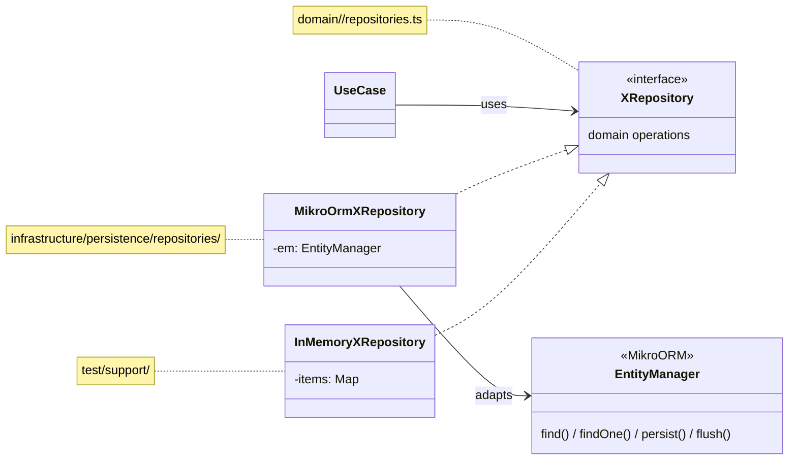
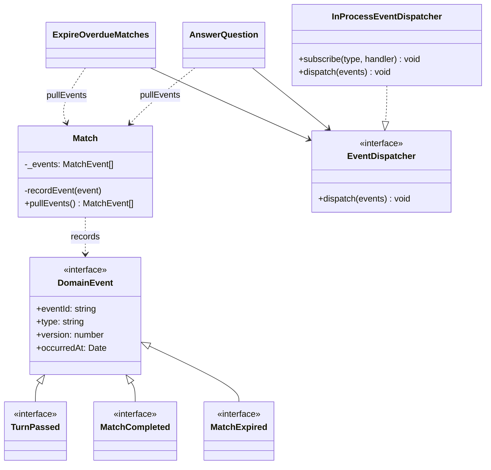
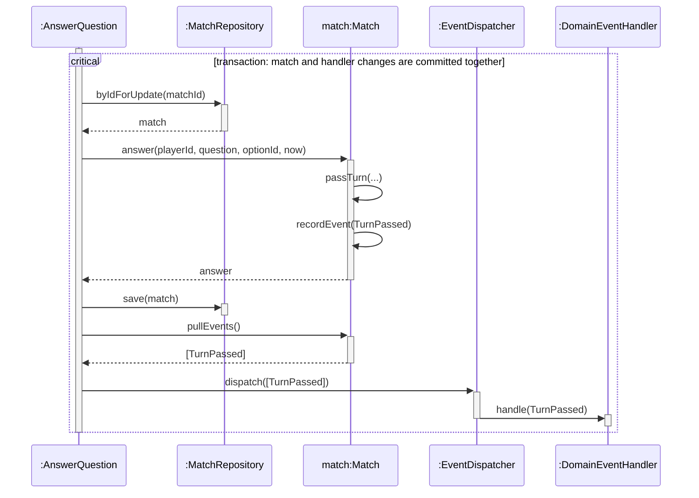
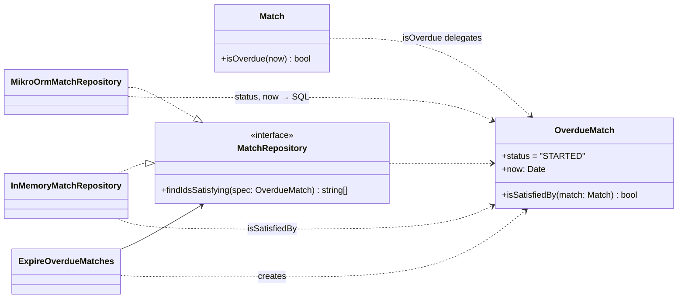
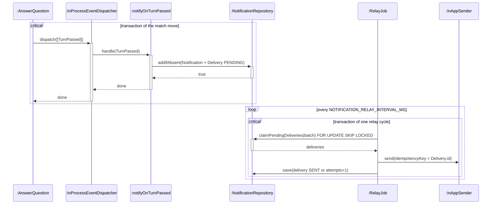
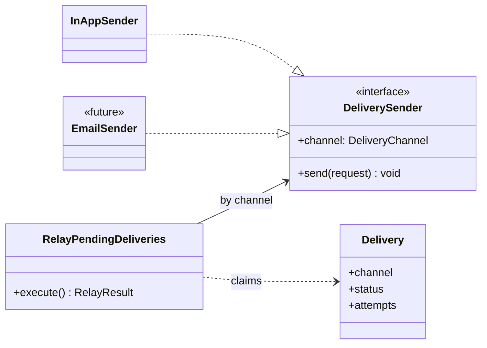

# Design Document

## 1. Project overview

**Quizduel** is a multiplayer quiz game for practising languages. Players create an account,
choose a game mode, and compete in matches by answering questions by category and difficulty. The
game supports four modes: Solo (random opponent), Solo with Friend, Teams, and Tournament. Players
earn scores, badges and daily quest rewards, and can invite friends, form teams and share results.
Players do not need to be online at the same time as their opponent: a match is played in turns,
and each player has a deadline for their turn.

Implemented so far (iteration 1): a 1vs1 match against a random opponent, with categories,
questions, turn deadlines and match expiry. In iteration 2, players are told about their turn and
about the end of a match by in-app notifications (see 4.2).

| Concern  | Choice                                                          |
| -------- | --------------------------------------------------------------- |
| Frontend | React SPA (TanStack Router and Query, PrimeReact)               |
| Backend  | Hono on Bun, TypeScript                                         |
| Database | PostgreSQL, mapped with MikroORM (`EntitySchema`)               |
| Cache    | Redis / Valkey (planned, for live match state and leaderboards) |

---

## 2. Domain discovery and modeling

### 2.1 EventStorming

> Full board: [`docs/Eventstorming.pdf`](./Eventstorming.pdf)

The EventStorming board follows a player from creating an account to the end of a match. It
splits the domain into five bounded contexts:

| Bounded context | Aggregate(s)                  | Main events                                                                                                                                                       |
| --------------- | ----------------------------- | ----------------------------------------------------------------------------------------------------------------------------------------------------------------- |
| Account/Profile | Player Profile                | account created, user logged in, language chosen                                                                                                                  |
| Matchmaking     | Lobby, Invitation, Tournament | game mode selected, random opponent found, friend accepted challenge, team formed, games assigned, tournament ended                                               |
| Match           | Match                         | match started, difficulty level chosen, round started, category chosen, question answered, question time expired, round completed, match completed, match expired |
| Gamification    | Rewards                       | score calculated, leaderboard changed, badge earned, daily quest completed, reward claimed                                                                        |
| Social          | Player Invitation             | results were shared, friend invited, friend accepted, friend request expired                                                                                      |

The policies on the board connect the contexts and describe the rules of a match:

- _When a game mode is selected,_ Matchmaking starts the search, the challenge or the team
  formation; once players are found, a match is started.
- _When a category is chosen,_ the opponent gets a "question ready" notification (external
  notification provider).
- _When a round is left,_ the next round starts; otherwise the match is completed.
- _When the turn deadline passed,_ the match expires.
- _When a match is completed,_ Gamification calculates the score and updates daily quests and
  badges; in a tournament, the next match or phase is started.
- _When a friend request is not accepted within 48 h,_ it expires.

### 2.2 Domain model

> Full diagram: [`docs/DomainModel.pdf`](./DomainModel.pdf) (source:
> [`DomainModel.drawio`](./DomainModel.drawio))

The model has one package per bounded context from 2.1, plus a **Catalog** package for the
questions, which several contexts read.

- **Account / Profile:** a **Player** has a username, email and country, learns **Language**s and
  has friends. It can calculate its total score and invite other players.
- **Matchmaking:** a **Lobby** holds the chosen game mode (`SOLO_RANDOM`, `SOLO_FRIEND`, `TEAMS`,
  `TOURNAMENT`), the play mode (`TURN_BASED`, `REAL_TIME`) and its status (`SEARCHING`, `READY`,
  `STARTED`). A **MatchInvitation** is a `CHALLENGE` (1vs1) or `TEAM` invitation. A **Team** groups
  players. A **Tournament** has a phase (`REGISTRATION`, `GROUP_PHASE`, `ELIMINATION`, `ENDED`) and
  owns its **TournamentGroup**s and **EliminationRound**s.
- **Quiz Match:** a **Match** has a game mode, play mode, difficulty and status (`UPCOMING`,
  `STARTED`, `COMPLETED`, `EXPIRED`). It consists of **Round**s, each with a deadline and the time
  its question was shown. A **PlayerAnswer** records the time a player needed and whether the
  answer was correct. A **PlayerConnection** tracks whether a player is online in a real-time
  match.
- **Catalog:** a **Category** contains **Question**s. A question has a text, difficulty and time
  limit, and exactly four **AnswerOption**s, one of them correct.
- **Gamification:** a **Score** records the points of a player in a match. **Reward** is
  abstract, with the subclasses **Badge** and **DailyQuest**. **RewardProgress** tracks a player's
  progress towards a reward.
- **Social:** a **FriendRequest** has a status and an expiry date; a **SocialShare** records
  results shared on another platform.

**Why these decisions?**

- **`Match` is the aggregate root of `Round` and `PlayerAnswer`.** Rounds and answers only change
  through the match, so it can enforce whose turn it is and the deadline.
- **`Catalog` as its own package.** Questions and categories are read by the match, but they are
  maintained independently of any match.
- **`Reward` is abstract.** `Badge` and `DailyQuest` share name, description and condition; only
  their specific attributes differ.
- **`RewardProgress` as a separate class.** It sits between `Player` and `Reward` and tracks
  progress and claiming without changing either class.
- **`MatchInvitation` separate from `FriendRequest`.** Game invitations and friend requests have
  different lifecycles.
- **`Tournament` owns `TournamentGroup` and `EliminationRound`.** The two phases have different
  structures, so each is its own owned object.
- **`PlayMode` and `PlayerConnection`** were added for the change scenario in 4.1.
- **Notification:** a **Notification** (type `TURN_PASSED`, `MATCH_COMPLETED` or `MATCH_EXPIRED`)
  belongs to one recipient and refers to a match by ID only. It owns one **Delivery** per channel
  (`IN_APP`, `EMAIL`) with a status (`PENDING`, `SENT`, `FAILED`). It was added for the change
  scenario in 4.2.

---

## 3. High-level architecture

> Full diagram: [`docs/ComponentDiagram.pdf`](./ComponentDiagram.pdf) (source:
> [`ComponentDiagram.drawio`](./ComponentDiagram.drawio))

The system is divided into four subsystems:

1. **Client:** the `React Web App (SPA)` talks to the backend over REST/HTTP, and over WebSocket
   for real-time matches.
2. **Server / API:** the `Backend API Server (Hono / Bun)`, one deployable with one module per
   bounded context (the "services" in the diagram), plus the `Real-Time Gateway` (see 4.1).
3. **Persistence & Cache:** the `Main Database` (PostgreSQL) and the `In-Memory Cache`
   (Redis / Valkey), both used through interfaces.
4. **External systems:** an `Identity Provider` for login and a `Notification Provider` for push
   notifications.

| Module            | Responsibilities                                                                                          |
| ----------------- | --------------------------------------------------------------------------------------------------------- |
| Account / Profile | Create account, login, choose language. Aggregate: Player Profile.                                        |
| Matchmaking       | Game mode and play mode, player search, team formation, tournaments. Aggregate: Lobby.                    |
| Match / Gameplay  | Round play, question catalog, match control (start, expire, complete), turn-based and real-time policies. |
| Gamification      | Score and leaderboard, badges, daily quests, rewards.                                                     |
| Social            | Friends, results sharing, friend invitation notifications.                                                |
| Real-Time Gateway | Live match session (WebSocket), presence and reconnection.                                                |
| Notification      | Turns the match events into stored notifications, delivers them per channel, serves the bell (see 4.2).   |

| From              | To                    | Trigger                                                      |
| ----------------- | --------------------- | ------------------------------------------------------------ |
| Account / Profile | Matchmaking           | user logged in → select game mode                            |
| Matchmaking       | Match / Gameplay      | match created                                                |
| Match / Gameplay  | Gamification          | match completed → calculate score                            |
| Real-Time Gateway | Match / Gameplay      | answer received in a live match                              |
| Match, Social     | Notification Provider | question ready; friend invited                               |
| Match / Gameplay  | Notification          | turn passed, match completed or expired (domain events, 4.2) |
| Account / Profile | Identity Provider     | login, create account                                        |

The API is layered (see [architecture.md](architecture.md)); the modules are folders inside the
layers (e.g. `domain/match`, `domain/matchmaking`).

**Why these decisions?**

- **One module per bounded context, in one deployable.** Each module has one domain concern from
  the EventStorming, without the network calls and deployment of separate services.
- **Database and cache behind interfaces.** The storage technology can change without changing
  the modules.
- **Hono / Bun and React.** One language (TypeScript) in the frontend and the backend. Use Hono only in the http module, keep the domain module free from any frameworks.

---

## 4. Future change scenarios

### 4.1 Real-time play

> **"Players can play against each other in real time, not only in alternating rounds."**

#### 4.1.1 Context

Today, each player plays at their own time and gets a notification when it is their turn. In the
new scenario, a second play mode is added: **real time**.

- Players are online at the same time.
- Everyone sees the same question at the same moment, with a timer controlled by the server.
- When everyone has answered, or the time is over, the result is shown and the next question
  starts.
- If a player stays offline for too long, the match expires.

The **turn-based mode stays**, because players do not need to be online at the same time as their
opponent.

**Why this change is plausible.**

- It is a common feature in quiz apps. Users usually ask for it after the asynchronous mode
  already exists.
- It keeps the goal of the product (practising languages by playing against other people).
- It uses well-known technology (WebSocket).

**Parts of the system affected.**

| Part                                        | Impact                               |
| ------------------------------------------- | ------------------------------------ |
| Domain (`Lobby`, `Match`, `Round`)          | Small: new attributes                |
| Domain (player connection)                  | Medium: new class `PlayerConnection` |
| Client (React Web App)                      | Medium: live connection and timer    |
| Match / Gameplay Service                    | Small: new policies                  |
| Matchmaking Service                         | Small: choice of play mode           |
| Live connection handling                    | New                                  |
| Notification, Gamification, Social, Account | None                                 |

**Situation before the change.** The Match / Gameplay Service contains match control (start,
expire, complete), round play (choose category, show question, save answer) and the policies
(start the next round, expire when the deadline passes). The Matchmaking Service creates the
match; the Match Service notifies the opponent and calls the Gamification Service when the match
ends. Its cohesion is high: it only handles matches (functional cohesion). However, all policies
assume turns and notifications.

**Alternatives analysed.**

- **A. Everything in the Match Service.** The Match Service itself opens WebSocket connections,
  controls live timers and detects presence.
- **B. New Real-Time Gateway component + `PlayMode` in the domain.** A dedicated component handles
  the live connection. The Match Service keeps the rules and only gets new policies for real-time
  mode.
- **C. Separate service for real-time matches.** A full "Real-Time Match Service" with its own
  rules and model, next to the current Match Service.

#### 4.1.2 Coupling and cohesion

The analysis follows Khononov.

**Integrations per alternative.**

- **A. Everything in the Match Service.**
  - _A1, real-time policies ↔ match rules:_ the new policies (all answered → next question,
    offline too long → expire) work on the same rules as the turn-based ones and sit in the same
    component.
  - _A2, match rules ↔ WebSocket and presence:_ the game rules and the connection handling share
    almost no knowledge, but now live in the same component.
- **B. Real-Time Gateway + `PlayMode`.**
  - _B1, real-time policies ↔ match rules:_ as in A1, the policies sit in the Match module next to
    the rules they use.
  - _B2, Gateway → Match Service:_ the Gateway only calls the Match module's use cases and listens
    to its domain events. WebSocket and presence stay inside the Gateway.
- **C. Separate real-time service.**
  - _C1, real-time service ↔ turn-based service:_ both implement score, rounds and end of match,
    so the same rules exist in two services.
  - _C2, both services ↔ database and cache:_ both write the same match data.
  - _C3, Matchmaking → both services:_ Matchmaking creates a match in one of the two services
    through its interface.

| Integration                         | Strength                      | Distance         | Volatility | Result                    |
| ----------------------------------- | ----------------------------- | ---------------- | ---------- | ------------------------- |
| A1 Real-time policies ↔ match rules | functional                    | same component   | high       | Balanced (cohesion)       |
| A2 Match rules ↔ WebSocket/presence | low (little shared knowledge) | same component   | rules high | **Local complexity**      |
| B1 Real-time policies ↔ match rules | functional                    | same component   | high       | Balanced (cohesion)       |
| B2 Gateway → Match Service          | contract                      | other module     | low        | Balanced (loose coupling) |
| C1 Real-time ↔ turn-based service   | functional (duplicated rules) | separate service | high       | **Global complexity**     |
| C2 Both services ↔ database/cache   | intrusive (same tables)       | separate service | high       | **Global complexity**     |
| C3 Matchmaking → both services      | contract                      | separate service | low        | Balanced (loose coupling) |

**Summary.**

| Criterion                     | A                        | B        | C                          |
| ----------------------------- | ------------------------ | -------- | -------------------------- |
| Balance                       | Local complexity (A2)    | Balanced | Global complexity (C1, C2) |
| Testing rules without network | Hard                     | Good     | Medium                     |
| Effort                        | Low at first, high later | Medium   | High                       |
| Risk to what already exists   | High                     | Low      | Low                        |

#### 4.1.3 Decision and consequences

> **Alternative B was chosen:** create the **Real-Time Gateway** component and add the
> **`PlayMode`** concept (`TURN_BASED` or `REAL_TIME`) to the domain.

**Justification.**

1. **Strong coupling stays close (B1).** The real-time policies share the match rules and live
   next to them in the Match module.
2. **Weak coupling across the distance (B2).** The Gateway only uses the Match module's use cases
   and events, and the Match module does not know WebSocket. A change of transport technology only
   affects the Gateway.
3. **No duplicated rules.** Score, rounds and end of match stay in one component. The
   Gamification Service is still called only by the Match Service.
4. **Turn-based mode is protected.** Notifications, deadlines and match expiration do not change.

**Accepted costs.**

- One more component to maintain and monitor.
- The Match Service now has two families of policies (turn-based and real-time). If they grow,
  they can be split into strategies in the code.
- Reconnection and network failures must be handled, which was not needed before.

**Open points.**

- Rule for a speed-based score (the `timeNeeded` attribute of `PlayerAnswer` already allows it,
  but the rule is not defined).
- Maximum offline time before the match expires.
- Behaviour when the connection drops: expire the match or go back to turn-based mode.

**Effect on the diagrams.**

| Decision                                                  | Where it appears                                     |
| --------------------------------------------------------- | ---------------------------------------------------- |
| `PlayMode` in `Lobby` and `Match`                         | `DomainModel.drawio`                                 |
| `PlayerConnection` and `ConnectionStatus`                 | `DomainModel.drawio`                                 |
| Real-Time Gateway, `WebSocket` interface and dependencies | `ComponentDiagram.drawio`                            |
| `async:` and `real-time:` policies                        | `ComponentDiagram.drawio` (Match / Gameplay Service) |

**Implementation status: open.**

### 4.2 In-app notifications

> **"A player is told, inside the app, when something happens in their matches (their turn, a
> finished match, an expired match), even if the player is not looking at that match."**

#### 4.2.1 Context

In iteration 1 the notification was only a `<<use>>` dependency on the external Notification
Interface. In the new scenario the **Notification** bounded context is implemented:

- The domain events of the match (`TurnPassed`, `MatchCompleted`, `MatchExpired`, see 5.2) create
  a **Notification** for each affected player.
- Each Notification has one **Delivery** per channel. Today only `IN_APP` exists; `EMAIL` is a
  port without implementation.
- The web client shows a bell with an unread counter and learns about new notifications by
  polling.

**Why this change is plausible.**

- Players do not need to be online at the same time as their opponent (see 1), so they must be
  told when the match needs them.
- E-mail or push are a natural next request, so the context must accept new channels without
  changing the rules that decide who is notified.
- The Match context is owned by another team member, so the contract between both contexts must be
  explicit and small.

**Parts of the system affected.**

| Part                                                 | Impact                                                               |
| ---------------------------------------------------- | -------------------------------------------------------------------- |
| Notification context (domain, application, infra)    | New: `Notification`, `Delivery`, handlers, relay, repository         |
| Event contract (`domain/shared/events`)              | None: Notification uses the contract of the Match context as it is   |
| Composition root (`main.ts`)                         | Small: three subscriptions and the relay job                         |
| Backend API (HTTP)                                   | New: `GET /api/notifications` and `POST /api/notifications/:id/read` |
| Client (React Web App)                               | Medium: bell, polling with cursor and backoff                        |
| Database                                             | New tables `notification` and `notification_delivery`                |
| Match / Gameplay, Matchmaking, Gamification, Account | None                                                                 |

**Situation before the change.** Match and Social called the Notification Interface directly
(`<<use>>` arrows in the component diagram). There was no stored notification, no read state and
no guarantee that a notification is sent if, and only if, the match change was saved. A failure of
the provider could break the player's move or silently lose the notification of a turn. Cohesion
was low for notifications: the sending of messages was spread over the services that produce the
facts.

**Alternatives analysed.**

- **A. Direct calls.** The Match use cases (or a handler in the match transaction) call the
  provider for e-mail or push themselves.
- **B. Notification context with event subscription, transactional outbox and polling.** The
  context subscribes to the domain events, stores the Notification and its Deliveries in the
  transaction of the match, and a relay sends them afterwards. The client polls a small REST API.
- **C. Separate notification service with a message broker and push to the client.** Events go
  through a broker (e.g. RabbitMQ or Kafka), and the client holds a WebSocket or SSE connection.

#### 4.2.2 Coupling and cohesion

The analysis follows Khononov, as in 4.1.

**Integrations per alternative.**

- **A. Direct calls.**
  - _A1, Match use cases ↔ provider:_ Match decides when to notify, in which format and how often
    to retry; every new channel changes match code.
  - _A2, match transaction ↔ provider availability:_ a provider failure can break or lose a
    notification, because the call cannot take part in the database transaction.
- **B. Notification context + outbox + polling.**
  - _B1, Notification handlers → event contract:_ the handlers know the events, not the Match
    classes. The contract is versioned.
  - _B2, handlers ↔ Notification model and outbox:_ the rules "who is told what" and the delivery
    state live together in one module.
  - _B3, relay → `DeliverySender` port:_ the relay knows only the port; channels are adapters.
  - _B4, client → REST API:_ the client knows an HTTP interface with a cursor, not the database.
- **C. Separate service with a broker.**
  - _C1, Match → broker → Notification service:_ events become messages between deployables; the
    contract is the same as in B1, but with a network between the two.
  - _C2, Match database ↔ broker:_ the message and the match change must be saved together, which
    needs an outbox anyway.

| Integration                      | Strength   | Distance         | Volatility | Result                             |
| -------------------------------- | ---------- | ---------------- | ---------- | ---------------------------------- |
| A1 Match ↔ provider              | model      | external system  | high       | **Global complexity**              |
| A2 Match transaction ↔ provider  | functional | external system  | high       | **Global complexity**              |
| B1 Handlers → event contract     | contract   | other module     | low        | Balanced (loose coupling)          |
| B2 Handlers ↔ Notification model | functional | same module      | high       | Balanced (cohesion)                |
| B3 Relay → `DeliverySender`      | contract   | same module      | high       | Balanced (loose coupling)          |
| B4 Client → REST API             | contract   | other deployable | low        | Balanced (loose coupling)          |
| C1 Match → broker → Notification | contract   | separate service | low        | Balanced, high infra cost          |
| C2 Match database ↔ broker       | functional | separate system  | high       | **Global complexity** (dual write) |

**Summary.**

| Criterion                              | A                          | B                             | C                              |
| -------------------------------------- | -------------------------- | ----------------------------- | ------------------------------ |
| Balance                                | Global complexity (A1, A2) | Balanced                      | Dual write needs an outbox too |
| Notification sent if and only if saved | No                         | Yes (same transaction)        | Only with an outbox            |
| Effort and new infrastructure          | Low at first, high later   | Medium, no new infrastructure | High (broker, push gateway)    |
| Test without network                   | Hard                       | Good                          | Medium                         |

**Cohesion.**

| Criterion                          | Before (direct `<<use>>` calls)       | After (Notification context)                               |
| ---------------------------------- | ------------------------------------- | ---------------------------------------------------------- |
| Responsibility of Match            | Rules **and** the sending of messages | Only rules; it publishes events                            |
| Responsibility of Notification     | Does not exist                        | Create, store, deliver and read notifications (functional) |
| Reasons for Notification to change | -                                     | New channel, new notification type, delivery policy        |
| Repeated rules                     | Each service decides when to notify   | One place maps events to recipients                        |

#### 4.2.3 Decision and consequences

> **Alternative B was chosen:** a **Notification context** that subscribes to the domain events of
> the Match context, stores each Notification with its Deliveries as a **transactional outbox**,
> and is read by the client through a **polling API with a cursor**.

**Justification.**

1. **Strong coupling stays close (B2, B3).** The rules for recipients, the delivery state and the
   senders are in one module.
2. **Weak coupling across the distance (B1, B4).** Notification depends only on the event contract
   and the client only on a small REST interface. The Biome rule of D6 makes this a CI check.
3. **Sent if and only if saved.** The outbox rows are written in the transaction of the match; no
   distributed transaction is needed.
4. **No new infrastructure.** The relay is a polling job on the existing database. C remains
   possible later: only the transport changes.

**Pattern references.** The context is built around the _Transactional Outbox_
([microservices.io](https://microservices.io/patterns/data/transactional-outbox.html)). Its terms
are used in the code and diagrams: _Sender_ (the code that changes the state), _Database_,
_Message outbox_ (a table that stores the messages) and _Message relay_ (a process that reads the
outbox and publishes). The pattern guarantees that messages are sent if and only if the
transaction commits. The relay has two known implementations, _Polling publisher_ and
_Transaction log tailing_; because it "may publish a message more than once", consumers must be
idempotent. For the client we follow Anubhav, [_System Design Day 14: Polling — The Simplest
Communication Pattern in Distributed Systems_](https://medium.com/@anubhav020909/system-design-day-14-polling-the-simplest-communication-pattern-in-distributed-systems-ebd78057e9eb)
(Medium, 29/12/2025): fixed-interval polling is simple and plain HTTP, and it fits infrequent
updates, no strict real-time need and moderate scale. In the records below, **Outbox** means the
first source and **Polling** the second. How each pattern appears in the code is in 5.4 to 5.9.

##### D1. Event contract between Match and Notification

| Option                                                                 | Assessment                                                     |
| ---------------------------------------------------------------------- | -------------------------------------------------------------- |
| A. Notification calls Match code or queries its tables                 | Direct coupling to another context, no isolation               |
| B. Own event contract defined by Notification                          | Two contracts for the same facts; the publisher owns the facts |
| C. **Use the contract of the Match context in `domain/shared/events`** | One contract, versioned, already published by its owner        |

**Choice: C.** Notification subscribes to `TurnPassed`, `MatchCompleted` and `MatchExpired` with
`InProcessEventDispatcher.subscribe` in `main.ts`. It imports only `domain/shared/events`.
The contract is described in [events.md](events.md); the types are the authority.

**Rationale.** An early draft of the contract was replaced by the one the Match context published,
which has the same purpose and more detail (for example `TurnPassed.deadline`). The cost of the
change was one module of handlers, which shows that the isolation of D6 works.

##### D2. Handlers run in the match transaction, deliveries go through the outbox

| Option                                                                                  | Assessment                                                             |
| --------------------------------------------------------------------------------------- | ---------------------------------------------------------------------- |
| A. Handler sends the message itself                                                     | The transaction can still roll back; a failing provider fails the move |
| B. In-app notification visible when saved; only e-mail uses the relay                   | Two code paths; the in-app channel would not exercise the pattern      |
| C. **Handler saves Notification + `PENDING` Deliveries; the relay sends every channel** | One path for all channels; a new channel needs only a new sender       |

**Choice: C.** The handlers run inside the transaction of the use case that dispatched the event
(the dispatcher is called after `save`, see 5.2), so the match change and its notifications are
saved together or not at all. `InAppSender` only succeeds and marks the delivery `SENT`. Read is a
separate state (`readAt`): a notification can be sent and unread.

**Rationale.** The table of `Delivery` rows with status `PENDING` is the Message outbox, the job is
the Message relay (Outbox). A handler that only writes rows is fast and cannot fail because of an
external system, which was the restriction found in 5.2.

##### D3. What the Notification stores

| Option                                                              | Assessment                                |
| ------------------------------------------------------------------- | ----------------------------------------- |
| A. Only the type and an id; read the rest from Match when shown     | Cross-context queries; breaks isolation   |
| B. Final text stored in the database                                | Fixes language and wording in the backend |
| C. **Type, `eventId`, `recipientId`, `matchId` and a small `data`** | Self-contained, no cross-context query    |

**Choice: C.** The `data` of each type is a small flat object, from the point of view of the
recipient: `TURN_PASSED` has `roundNumber`, `fromPlayerId` and `deadline`; `MATCH_COMPLETED` has
`outcome` (`WON`, `LOST`, `DRAW`) and `winnerId`; `MATCH_EXPIRED` has `outcome` (`WON`, `LOST`,
`NO_WINNER`), `winnerId` and `missedByPlayerId`. The text is built in the client from `type` and
`data`.

**Rationale.** The context must be readable without asking Match. An expired match where nobody
answered has no winner (rule of the Match context), so it is `NO_WINNER`, not a draw. Text stays in
the client, where language and wording change often.

##### D4. Message relay and retries

| Option                                                            | Assessment (Outbox)                                                      |
| ----------------------------------------------------------------- | ------------------------------------------------------------------------ |
| A. Transaction log tailing                                        | No delay, but needs database-specific tooling (CDC) and infrastructure   |
| B. **Polling publisher, fixed-interval retries, at most N tries** | Plain SQL on the current database; the cost is a small delay and queries |
| C. Polling publisher with exponential backoff per delivery        | Fewer wasted attempts, but needs a `nextAttemptAt` column and more rules |

**Choice: B.** An interval job started in `main.ts` (`NOTIFICATION_RELAY_INTERVAL_MS`, default
1000) selects `PENDING` deliveries in batches with `FOR UPDATE SKIP LOCKED` inside a transaction,
tries each once through the sender of its channel and records the result. A failure counts an
attempt; after `NOTIFICATION_MAX_ATTEMPTS` (default 5) the delivery is `FAILED` (terminal). A cycle
never overlaps with the previous one.

**Rationale.** The load is low (a few notifications per match). `SKIP LOCKED` lets two API
instances run the relay without taking the same row. If the volume grows, the relay can be replaced
by log tailing without changing handlers or senders. Backoff is a step for a real external channel.

##### D5. Idempotency

| Option                                                              | Assessment                                                               |
| ------------------------------------------------------------------- | ------------------------------------------------------------------------ |
| A. Check in the handler (`exists`), unique constraint as backstop   | Race: the losing insert fails and, in the match transaction, aborts it   |
| B. Savepoint per handler in the dispatcher                          | The dispatcher of the Match context does not do this; it would change it |
| C. **`INSERT ... ON CONFLICT (event_id, recipient_id) DO NOTHING`** | Atomic, no error, no change to the dispatcher                            |

**Choice: C.** `NotificationRepository.addIfAbsent` inserts the notification and, only when the row
was inserted, its deliveries. A duplicate returns `false` and is ignored. The `Delivery.id` is the
idempotency key passed to senders.

**Rationale.** The relay and the dispatcher are at-least-once, so consumers must be idempotent
(Outbox). A duplicate must never roll back the match change: a savepoint in the dispatcher was
considered and dropped, because the in-process dispatcher does not provide it and the database can
solve the case alone. Ordering between notifications is not guaranteed, which is acceptable since
each is independent and the list is ordered by when it became visible (D7).

##### D6. Isolation enforced by tool

| Option                                      | Assessment                                   |
| ------------------------------------------- | -------------------------------------------- |
| A. Convention in the documentation          | Easy to break in a review that is in a hurry |
| B. **Biome `noRestrictedImports` override** | Fails the CI when the rule is broken         |

**Choice: B.** An override in the root `biome.json` for the notification files forbids imports of
`domain/match`, `domain/matchmaking` and the barrels that re-export them. Allowed: `domain/shared`
(events, errors) and the notification code itself.

**Rationale.** D1 is only worth something if it is enforced: low coupling is checked by
`bunx biome ci .`, not by memory.

##### D7. Polling API: cursor, no ETag

| Option                         | Assessment (Polling)                                               |
| ------------------------------ | ------------------------------------------------------------------ |
| A. Always return the full list | Simple, but repeats data and the cost grows with the history       |
| B. **Cursor (`since`)**        | Returns only new items; an idle poll is a small body with no items |
| C. Cursor and ETag / `304`     | Saves a few bytes more, but needs server state and client logic    |

**Choice: B.** `GET /api/notifications?since=<cursor>&limit=<1..50, default 20>` returns
`{ items, unreadCount, cursor }`. The cursor is opaque: the position `(sentAt, id)` of the newest
item returned, and it stays the same if nothing is new. Items are ordered by the `sentAt` of the
`IN_APP` delivery, then by `id`. With `since`, the server returns the **oldest** `limit` items after
the cursor (shown newest first) and the cursor moves to the newest of them, so a backlog larger
than `limit` arrives over successive polls with no gap. `POST /api/notifications/:id/read` returns
`204`, is idempotent, and answers `404` when the notification is not the caller's.

**Rationale.** Sorting by `createdAt` would be wrong: an item is visible only after the relay sent
it, so one created earlier but sent later would land behind the client cursor and never be
returned. With `sentAt` the stream only grows at its end, as a cursor needs. ETag was built first
and then removed (see 5.9): with the cursor an idle poll is already tiny, and the ETag doubled the
client logic.

##### D8. Client polling policy

| Option                                                 | Assessment (Polling)                                 |
| ------------------------------------------------------ | ---------------------------------------------------- |
| A. Short polling (around 300 ms)                       | Called an anti-pattern: load without benefit         |
| B. Long polling, SSE or WebSocket now                  | Connection handling; too much for infrequent updates |
| C. **Fixed interval, 5 s, with cursor, a lean client** | Simplest, plain HTTP, no extra infrastructure        |

**Choice: C.** React Query polls every 5 s with `since`, merges new items on top (deduplicated by
`id`) and takes `unreadCount` from the server. It pauses when the tab is hidden
(`refetchIntervalInBackground: false`), makes a **full resync** (no `since`) when the window gets
focus and after marking as read, and backs off on errors (5 s, 10 s, 20 s, up to 60 s, back to 5 s
after a success). The cache keeps the newest 20 items, the size of a full page of the server
(`NOTIFICATIONS_PAGE_SIZE`, equal to the server default `DEFAULT_LIMIT`, below its maximum).

**Rationale.** A turn-based game has infrequent updates and moderate scale, where Polling says that
polling fits. The client is deliberately small (one small file, `apps/web/src/lib/notifications.ts`). **Evolution path:** when
scale or latency demand it, replace polling by push (SSE or WebSocket); the outbox, handlers,
`Notification` model and API view stay, and the Real-Time Gateway (4.1) is a possible host.

##### D9. Cursor on `sentAt` and the multi-relay risk

`sentAt` is set by the relay inside its transaction. If two relays run at the same time, relay X
may take `sentAt = t1` but commit after relay Y committed an item with `t2 > t1` and a client has
polled past `t2`; the item of X is then behind the cursor.

| Option                                  | Assessment                                                                              |
| --------------------------------------- | --------------------------------------------------------------------------------------- |
| A. Cursor lookback (overlap window)     | More data per poll, and the window must exceed the longest relay transaction            |
| B. Periodic full resync on the client   | Safety net, but more requests and more client state                                     |
| C. **Accept the risk, resync on focus** | No extra code. Today a single in-process relay with an overlap guard, so no race exists |

**Choice: C.** **Accepted risk:** with several relays an item may appear only after the next focus
resync. If the API is scaled out, option A is the next step.

**Accepted costs.**

- Delivery is **eventually consistent**: a notification appears after the next relay cycle (about
  1 s) and the next client poll (up to 5 s).
- Duplicates are possible at the relay, so consumers and senders must be idempotent.
- Polling creates constant (small) traffic, one request per open tab every 5 s.
- The handlers run in the request of the match: if one fails, the move fails (see 5.2).

**Open points.**

- Retention of old notifications and a limit of the table size.
- When to add the `EMAIL` channel, and a backoff policy for it.
- When to replace polling by SSE or WebSocket.
- Several relays: cursor lookback (D9).

**Effect on the diagrams.**

| Decision                                                                              | Where it appears                                        |
| ------------------------------------------------------------------------------------- | ------------------------------------------------------- |
| `Notification`, `Delivery`, `NotificationType`, `DeliveryChannel`, `DeliveryStatus`   | `DomainModel.drawio` (package Notification)             |
| Notification Service (handlers, repository / outbox, message relay, `DeliverySender`) | `ComponentDiagram.drawio`                               |
| Match → events → Notification handlers → outbox → relay                               | `ComponentDiagram.drawio`                               |
| Web client → `GET /api/notifications`, `POST /api/notifications/:id/read`             | `ComponentDiagram.drawio` (Notifications API interface) |

The old arrows Match → Notification Interface and Social → Notification Interface were kept but
rerouted; the external Notification Interface is reused (future `EmailSender`). The `.drawio`
sources are up to date; the PDFs were not regenerated for iteration 2.

**Implementation status: implemented (iteration 2).**

---

## 5. Existing design pattern instances

### 5.1 Storing aggregates without depending on the ORM — Repository implemented as an Adapter

#### Problem in context

The use cases have to load, find, lock and save the aggregates of three bounded contexts:
`Category` and `Question` (catalog), `Lobby` (matchmaking) and `Match` (match). Each aggregate also has its own queries, and each query has to be named in domain terms, for example "the oldest open lobby", "random questions that fit the round" and "matches whose turn deadline has passed". Finally, the
use cases have to be testable without a database.

#### The pattern: selection and implementation

**Pattern and rationale.** _Repository_ (Evans, DDD ch. 6): an object that looks like a collection of aggregates and hides how they are stored. Its interface is part of the domain. The implementation is an _Adapter_ (GoF, object adapter): it makes the MikroORM
`EntityManager` (the adaptee) fit the interface the domain expects (the target). We chose it because the domain then names the operations it needs, and only the adapter knows how they are
done in the database. A second adapter keeps the aggregates in memory for the tests.

**Mapping to the implementation.**

| Pattern role                  | Concrete implementation                                                                                                                                                                                                                                                                                                                                                                                                                                                                                | Explanation                                                                                                                   |
| ----------------------------- | ------------------------------------------------------------------------------------------------------------------------------------------------------------------------------------------------------------------------------------------------------------------------------------------------------------------------------------------------------------------------------------------------------------------------------------------------------------------------------------------------------ | ----------------------------------------------------------------------------------------------------------------------------- |
| Target (Repository interface) | [`CategoryRepository`](../apps/api/src/domain/catalog/repositories.ts#L19), [`QuestionRepository`](../apps/api/src/domain/catalog/repositories.ts#L5), [`LobbyRepository`](../apps/api/src/domain/matchmaking/repositories.ts#L4), [`MatchRepository`](../apps/api/src/domain/match/repositories.ts#L4)                                                                                                                                                                                                | One interface per aggregate, in the aggregate's bounded context. Category and Question are read-only, so they have no `save`. |
| Adapter                       | [`MikroOrmCategoryRepository`](../apps/api/src/infrastructure/persistence/repositories/mikro-orm-category.repository.ts#L4), [`MikroOrmQuestionRepository`](../apps/api/src/infrastructure/persistence/repositories/mikro-orm-question.repository.ts#L4), [`MikroOrmLobbyRepository`](../apps/api/src/infrastructure/persistence/repositories/mikro-orm-lobby.repository.ts#L5), [`MikroOrmMatchRepository`](../apps/api/src/infrastructure/persistence/repositories/mikro-orm-match.repository.ts#L5) | Implements the interface by calling the ORM.                                                                                  |
| Adaptee                       | MikroORM `EntityManager`, passed to each adapter's constructor (e.g. [here](../apps/api/src/infrastructure/persistence/repositories/mikro-orm-match.repository.ts#L6))                                                                                                                                                                                                                                                                                                                                 | Knows SQL, locks and the identity map, but nothing about the domain's terms.                                                  |
| Second adapter (tests)        | [`InMemoryCategoryRepository`](../apps/api/test/support/in-memory-repositories.ts#L18), [`InMemoryQuestionRepository`](../apps/api/test/support/in-memory-repositories.ts#L26), [`InMemoryLobbyRepository`](../apps/api/test/support/in-memory-repositories.ts#L47), [`InMemoryMatchRepository`](../apps/api/test/support/in-memory-repositories.ts#L78)                                                                                                                                               | The same interfaces, implemented with `Map`s and arrays.                                                                      |
| Client                        | Use cases via the [`Repositories`](../apps/api/src/application/index.ts#L30-L36) bundle                                                                                                                                                                                                                                                                                                                                                                                                                | Only the interfaces are visible to them.                                                                                      |
| Choosing the adapter          | [`mikroOrmRepositories`](../apps/api/src/infrastructure/persistence/repositories/index.ts#L9-L17), used in [`main.ts`](../apps/api/src/main.ts#L22); tests: [`inMemoryUseCases`](../apps/api/test/support/in-memory-repositories.ts#L104)                                                                                                                                                                                                                                                              | The composition root decides which adapter the use cases get.                                                                 |

How the adapters translate the domain's operations:

| Domain operation                                                                                                                                                                                                        | Translation in the MikroORM adapter                                                                                                                                                                                                  |
| ----------------------------------------------------------------------------------------------------------------------------------------------------------------------------------------------------------------------- | ------------------------------------------------------------------------------------------------------------------------------------------------------------------------------------------------------------------------------------ |
| [`LobbyRepository.lockMatchmaking`](../apps/api/src/domain/matchmaking/repositories.ts#L9)                                                                                                                              | Postgres advisory lock [`pg_advisory_xact_lock`](../apps/api/src/infrastructure/persistence/repositories/mikro-orm-lobby.repository.ts#L12-L15), released when the transaction ends                                                  |
| [`LobbyRepository.findOpenFor`](../apps/api/src/domain/matchmaking/repositories.ts#L15)                                                                                                                                 | [Filtered query, oldest first](../apps/api/src/infrastructure/persistence/repositories/mikro-orm-lobby.repository.ts#L17-L28)                                                                                                        |
| [`QuestionRepository.pickRandom`](../apps/api/src/domain/catalog/repositories.ts#L10)                                                                                                                                   | [Query with `ORDER BY random()` and `LIMIT`](../apps/api/src/infrastructure/persistence/repositories/mikro-orm-question.repository.ts#L7-L22)                                                                                        |
| [`MatchRepository.byIdForUpdate`](../apps/api/src/domain/match/repositories.ts#L11)                                                                                                                                     | [`SELECT … FOR UPDATE`](../apps/api/src/infrastructure/persistence/repositories/mikro-orm-match.repository.ts#L12-L19) with `refresh`, so the locked row's current state is used                                                     |
| [`MatchRepository.findIdsSatisfying`](../apps/api/src/domain/match/repositories.ts#L11)                                                                                                                                 | [Query built from the `OverdueMatch` specification](../apps/api/src/infrastructure/persistence/repositories/mikro-orm-match.repository.ts#L25-L34) (see 5.3); returns raw ids, so partly loaded matches stay out of the identity map |
| `save` ([Lobby](../apps/api/src/infrastructure/persistence/repositories/mikro-orm-lobby.repository.ts#L37-L39), [Match](../apps/api/src/infrastructure/persistence/repositories/mikro-orm-match.repository.ts#L36-L38)) | `em.persist(x).flush()`                                                                                                                                                                                                              |

**Illustration:** (`X` stands for Category, Question, Lobby or Match)

#### Consequences and alternatives

- **+** The domain and the use cases do not import MikroORM. Changing the ORM or the database
  only changes the adapters.
- **+** All use case tests run on the in-memory adapters, without a database.
- **−** Each interface has two implementations, which must behave the same. The tests only run the
  in-memory one, so a wrong query in the MikroORM adapter is not caught by them.
- **−** Some rules are written in both adapters (see 5.3).

_Alternatives:_ use the `EntityManager` directly in the use cases (less code, but the
application layer then depends on the ORM and cannot be tested without a database). Also it puts persistence into the domain classes, which conflicts with a
framework-free domain.

### 5.2 Reacting to match changes without coupling to the Match — Domain Event Pattern

#### Problem in context

When the turn goes to the other player, or a match is completed or expires, other parts of the
system have to react: notify the player whose turn it is now, update statistics, badges and daily
quests. These parts belong to other bounded contexts (notifications, gamification). If `Match` or
the use cases called them directly, the match context would depend on all of them, and each new
reaction would change the match code. At the same time, their changes have to be saved together
with the change of the match, or not at all.

#### The pattern: selection and implementation

**Pattern and rationale.** _Domain Event_ (Fowler, Evans): the aggregate records that something important happened, as an immutable
object with a name in the language of the domain. We use the variant in which the aggregate only
_collects_ its events and the use case _dispatches_ them after saving. So the domain does not need a dispatcher, and the events are delivered inside
the same transaction.

**Mapping to the implementation.**

| Pattern role                | Concrete implementation                                                                                                                                                                                                                                                                                                                                                                     | Explanation                                                                                                                      |
| --------------------------- | ------------------------------------------------------------------------------------------------------------------------------------------------------------------------------------------------------------------------------------------------------------------------------------------------------------------------------------------------------------------------------------------- | -------------------------------------------------------------------------------------------------------------------------------- |
| Event contract              | [`DomainEvent`](../apps/api/src/domain/shared/events/domain-event.ts#L8); [`TurnPassed`](../apps/api/src/domain/shared/events/match-events.ts#L7), [`MatchCompleted`](../apps/api/src/domain/shared/events/match-events.ts#L19), [`MatchExpired`](../apps/api/src/domain/shared/events/match-events.ts#L32), union [`MatchEvent`](../apps/api/src/domain/shared/events/match-events.ts#L42) | `eventId`, `type`, `version`, `occurredAt` plus event data. Kept outside the Match context, so subscribers do not depend on it.  |
| Publisher (aggregate)       | [`Match.recordEvent`](../apps/api/src/domain/match/match.ts#L350-L353), called in [`expireIfOverdue`](../apps/api/src/domain/match/match.ts#L240), [`completeRound`](../apps/api/src/domain/match/match.ts#L306) and [`passTurn`](../apps/api/src/domain/match/match.ts#L327)                                                                                                               | The match decides _what_ happened; it gives each event its `eventId`.                                                            |
| Collected events            | [`_events`](../apps/api/src/domain/match/match.ts#L27), [`pullEvents`](../apps/api/src/domain/match/match.ts#L300)                                                                                                                                                                                                                                                                          | Not persisted. `pullEvents` empties the list, so each event is dispatched only once.                                             |
| Dispatcher interface (port) | [`EventDispatcher`](../apps/api/src/application/event-dispatcher.ts#L8-L10)                                                                                                                                                                                                                                                                                                                 | In the application layer, so the domain has no dependency on it.                                                                 |
| Dispatch point              | [`AnswerQuestion`](../apps/api/src/application/answer-question.ts#L33-L35), [`ExpireOverdueMatches`](../apps/api/src/application/expire-overdue-matches.ts#L28-L29)                                                                                                                                                                                                                         | After `save`, inside the transaction.                                                                                            |
| Dispatcher                  | [`InProcessEventDispatcher`](../apps/api/src/infrastructure/events/in-process-event-dispatcher.ts#L11): [`subscribe`](../apps/api/src/infrastructure/events/in-process-event-dispatcher.ts#L14), [`dispatch`](../apps/api/src/infrastructure/events/in-process-event-dispatcher.ts#L23)                                                                                                     | Handlers per event type, called one after another in subscription order.                                                         |
| Handler                     | [`DomainEventHandler`](../apps/api/src/infrastructure/events/in-process-event-dispatcher.ts#L4); subscriptions in [`main.ts`](../apps/api/src/main.ts#L16-L20)                                                                                                                                                                                                                              | A function. The Notification context subscribes three handlers here (see 4.2 and 5.4); gamification will subscribe the same way. |

**Illustration:** structure. Neither `Match` nor the events depend on `EventDispatcher`; only the
use cases do, and only the infrastructure implements it.

Behaviour: answering the last question of a turn

#### Consequences and alternatives

- **+** `Match` does not know who reacts to it. A new reaction is a new subscription in the
  composition root; the match code does not change.
- **+** The events are a versioned contract ([architecture.md](architecture.md#domain-events)), so other
  contexts depend on them, not on `Match`.
- **+** Everything a handler writes is committed together with the match. If a handler throws, the
  whole change is rolled back.
- **−** Handlers run synchronously in the request. They must be fast, and a failing handler makes
  the player's move fail.
- **−** Every use case that changes a match has to call `dispatch(match.pullEvents())` after
  `save`. If one forgets it, the events are lost without an error.
- **−** External systems (e-mail, push) must not be called from a handler, because the
  transaction can still roll back afterwards.

_Alternatives:_ direct calls from the use cases (simple, but couples the match context to every
receiver). A static `DomainEvents.raise()` inside the domain makes the domain depend on a global dispatcher. A _Transactional Outbox_
(Richardson, _Microservices Patterns_) stores the events in the same transaction and delivers
them afterwards. The Notification context uses it for the delivery to its channels (see 5.5), so
its handlers only write rows and never call an external system.

### 5.3 One rule for overdue matches, in the domain and in the database — Specification

#### Problem in context

The expiry job needs every overdue match from the database, and the match itself has to reject
moves after the deadline. Both must use the same rule: "a running match whose turn deadline has
passed". Before, this rule was written twice: in the domain, in `Match.isOverdue`
(`status === "STARTED" && deadline !== null && now >= deadline`), and as a copy in SQL, in the
MikroORM repository's `findOverdueIds` (`{ _status: "STARTED", _turnDeadline: { $lte: now } }`).
This is _Duplicated Code_ (Fowler, _Refactoring_, ch. 3): the same knowledge written down twice.

- A change of the rule (e.g. a grace period, paused matches, or another rule for a real-time
  `PlayMode`, see 4.1) had to be made in two places.
- The tests could not catch a forgotten SQL change, because they use the in-memory repository,
  which called the domain rule.
- If the SQL finds _too many_ matches, nothing goes wrong: `ExpireOverdueMatches` checks each match
  again after locking it
  ([`expireIfOverdue`](../apps/api/src/application/expire-overdue-matches.ts#L26)). If it finds
  _too few_, those matches never expire, and nothing reports it.

#### The pattern: selection and implementation

**Pattern and rationale.** _Specification_ (Evans, Fowler):
the rule becomes an object of its own with `isSatisfiedBy(candidate)`. It can be used to check one
object and to select objects from a repository. The rule is now written only in `OverdueMatch`.
The match checks itself with it, the in-memory repository filters with it, and the database
repository turns its criteria (`status`, `now`) into the query. The repository method takes the
specification instead of a date, so the rule a caller selects by is visible in its signature.
There is only one specification so far, so there is no general `Specification<T>` interface yet.
It can be added when the next rule (see "Remaining" below) becomes a specification.

**Mapping to the implementation.**

| Pattern role                | Concrete implementation                                                                                                                      | Explanation                                                                                                                                                                                                        |
| --------------------------- | -------------------------------------------------------------------------------------------------------------------------------------------- | ------------------------------------------------------------------------------------------------------------------------------------------------------------------------------------------------------------------ |
| Specification               | [`OverdueMatch`](../apps/api/src/domain/match/overdue-match.ts#L10-L24)                                                                      | A value object holding the moment (`now`) and the required `status`.                                                                                                                                               |
| `isSatisfiedBy`             | [`OverdueMatch.isSatisfiedBy`](../apps/api/src/domain/match/overdue-match.ts#L17-L23)                                                        | The only place the rule is written.                                                                                                                                                                                |
| Candidate                   | [`Match`](../apps/api/src/domain/match/match.ts#L26) via its getters `status` and `turnDeadline`                                             |                                                                                                                                                                                                                    |
| Check of one object         | [`Match.isOverdue`](../apps/api/src/domain/match/match.ts#L121-L123)                                                                         | Delegates to the specification; it is used to reject moves ([`requirePlayableRound`](../apps/api/src/domain/match/match.ts#L375)) and to expire ([`expireIfOverdue`](../apps/api/src/domain/match/match.ts#L241)). |
| Selection from a repository | [`MatchRepository.findIdsSatisfying`](../apps/api/src/domain/match/repositories.ts#L11)                                                      | Takes the specification instead of a date.                                                                                                                                                                         |
| Selection in memory         | [`InMemoryMatchRepository.findIdsSatisfying`](../apps/api/test/support/in-memory-repositories.ts#L94-L96)                                    | Uses `isSatisfiedBy` directly.                                                                                                                                                                                     |
| Translation into a query    | [`MikroOrmMatchRepository.findIdsSatisfying`](../apps/api/src/infrastructure/persistence/repositories/mikro-orm-match.repository.ts#L25-L34) | Builds `status = 'STARTED' AND turn_deadline <= now` from the specification's fields. A `NULL` deadline never matches `<=`, which covers the null check.                                                           |
| Client                      | [`ExpireOverdueMatches`](../apps/api/src/application/expire-overdue-matches.ts#L15)                                                          | `findIdsSatisfying(new OverdueMatch(this.now()))`                                                                                                                                                                  |

**Illustration:**

#### Consequences and alternatives

- **+** The rule exists once in the domain. Changing it means changing `OverdueMatch` and, if the
  criteria change, its translation in one adapter.
- **+** The rule has a name and its own tests, independent of the match flow.
- **−** The translation into SQL still has to match `isSatisfiedBy`. A test against Postgres would
  make this safe.
- **−** One more class, and the repository interface depends on it.

_Alternatives:_ documenting the SQL as a prefilter that may find too many but never too few
(the rule would still exist twice), and a contract test that runs the same cases against the
Postgres repository and against the domain.

_Remaining:_ three more rules are still written in several places (see 6.1).

### 5.4 Patterns of the Notification context — overview

The Notification context (4.2) uses the patterns below. 5.2 describes the Domain Event pattern
and its in-process dispatcher, which this context only subscribes to; 5.5 to 5.8 describe the
others in the same form as 5.1 to 5.3; 5.9 lists patterns that were considered and not adopted.

| Pattern                                      | Problem it solves here                                                 | Where in the code                                                                                                                                                                                                                                       | Main trade-off                                                          |
| -------------------------------------------- | ---------------------------------------------------------------------- | ------------------------------------------------------------------------------------------------------------------------------------------------------------------------------------------------------------------------------------------------------- | ----------------------------------------------------------------------- |
| Domain Events, publish/subscribe (5.2)       | Notify without Match knowing the Notification context                  | [`domain/shared/events`](../apps/api/src/domain/shared/events/match-events.ts), [`InProcessEventDispatcher`](../apps/api/src/infrastructure/events/in-process-event-dispatcher.ts), subscriptions in [`main.ts`](../apps/api/src/main.ts)               | Synchronous, in the request; a failing handler fails the move           |
| Transactional Outbox (5.5)                   | Save the match change and its notifications together, never one only   | [`NotificationRecorder`](../apps/api/src/application/notification/notify.ts) (Sender), table `notification_delivery` (Message outbox), [`RelayPendingDeliveries`](../apps/api/src/application/notification/relay-pending-deliveries.ts) (Message relay) | Delivery is delayed by one relay cycle; at-least-once                   |
| Polling Publisher (5.5)                      | Move the rows from the outbox to the channels without new infra        | [`startNotificationRelayJob`](../apps/api/src/jobs/notification-relay-job.ts), `claimPendingDeliveries` with `FOR UPDATE SKIP LOCKED`                                                                                                                   | Repeated queries and a delay; replaceable by log tailing                |
| Idempotent Consumer (5.6)                    | Redelivered events must not duplicate notifications or abort the match | `NotificationRepository.addIfAbsent` in [`mikro-orm-notification.repository.ts`](../apps/api/src/infrastructure/persistence/repositories/mikro-orm-notification.repository.ts), unique `(event_id, recipient_id)`                                       | Plain SQL next to the ORM for one method                                |
| Ports and Adapters, senders by channel (5.7) | Add channels (e-mail) without changing the relay                       | [`DeliverySender`](../apps/api/src/domain/notification/delivery-sender.ts) (port), [`InAppSender`](../apps/api/src/application/notification/in-app-sender.ts) (adapter), `EmailSender` (future)                                                         | One more interface; the in-app adapter does nothing yet                 |
| Aggregate and Repository (5.8)               | Keep `Notification` and its `Delivery` rows consistent                 | [`Notification`](../apps/api/src/domain/notification/notification.ts), [`Delivery`](../apps/api/src/domain/notification/delivery.ts), [`NotificationRepository`](../apps/api/src/domain/notification/repositories.ts)                                   | The repository needs raw SQL for insert-if-absent and for the claim     |
| Fixed-interval polling with cursor (5.9)     | Keep the bell up to date without push infrastructure                   | [`ListNotifications`](../apps/api/src/application/notification/list-notifications.ts), [`cursor.ts`](../apps/api/src/application/notification/cursor.ts), [`notifications.ts`](../apps/web/src/lib/notifications.ts)                                    | Constant small traffic; up to about 5 s of delay; multi-relay risk (D9) |
| Shared event contract, enforced by lint      | Keep the contexts apart while they share a deployable                  | Event contract in `domain/shared/events`; the `noRestrictedImports` overrides in [`biome.json`](../biome.json)                                                                                                                                          | A lint rule must be kept up to date with the folder structure           |

### 5.5 Telling the player without tying delivery to the match transaction — Transactional Outbox with Polling Publisher

#### Problem in context

When a turn passes, the player whose turn it is must be notified. The notification may only exist
if the match change was saved (else the player is told about something that did not happen), and a
saved match change must not lose its notification. A call to an external system inside the
transaction cannot be rolled back, and a call after the commit can be lost if the process dies.
Writing to the database and to a channel are two writes with no common transaction (a _dual
write_).

#### The pattern: selection and implementation

**Pattern and rationale.** _Transactional Outbox_ (Richardson,
[microservices.io](https://microservices.io/patterns/data/transactional-outbox.html)): the message
is stored in a table of the same database, in the same transaction as the state change; a _Message
relay_ later reads the table and publishes. We use the _Polling publisher_ variant of the relay:
a job that queries the table at an interval. It needs no new infrastructure, unlike _transaction
log tailing_.

**Mapping to the implementation.**

| Pattern role      | Concrete implementation                                                                                                                                                                                                                                                                                                                                                       | Explanation                                                                                     |
| ----------------- | ----------------------------------------------------------------------------------------------------------------------------------------------------------------------------------------------------------------------------------------------------------------------------------------------------------------------------------------------------------------------------- | ----------------------------------------------------------------------------------------------- |
| Sender            | [`notifyOnTurnPassed`](../apps/api/src/application/notification/notify-on-turn-passed.ts), [`notifyOnMatchCompleted`](../apps/api/src/application/notification/notify-on-match-completed.ts), [`notifyOnMatchExpired`](../apps/api/src/application/notification/notify-on-match-expired.ts), via [`NotificationRecorder`](../apps/api/src/application/notification/notify.ts) | Handlers run in the match transaction and write the Notification and its `PENDING` Deliveries.  |
| Message outbox    | Table `notification_delivery`, rows with status `PENDING` ([schema](../apps/api/src/infrastructure/persistence/schemas/notification.schema.ts)); a partial index serves the relay query                                                                                                                                                                                       | The outbox is part of the model: a `Delivery` is a message with state and attempt count.        |
| Message relay     | [`RelayPendingDeliveries`](../apps/api/src/application/notification/relay-pending-deliveries.ts)                                                                                                                                                                                                                                                                              | One cycle: claim a batch, one attempt each, record the result, in one transaction.              |
| Polling publisher | [`startNotificationRelayJob`](../apps/api/src/jobs/notification-relay-job.ts), started in [`main.ts`](../apps/api/src/main.ts); `claimPendingDeliveries` uses `FOR UPDATE SKIP LOCKED`                                                                                                                                                                                        | Interval `NOTIFICATION_RELAY_INTERVAL_MS` (1000); a `running` flag prevents overlapping cycles. |
| Retry policy      | `Delivery.recordFailure(error, at, maxAttempts)`                                                                                                                                                                                                                                                                                                                              | Fixed interval: one attempt per cycle; after 5 attempts the delivery is `FAILED`.               |

**Illustration:** behaviour. The match move and the outbox rows are one commit; the relay is a
second, independent transaction.

#### Consequences and alternatives

- **+** A notification exists if and only if the match change was committed, without a
  distributed transaction.
- **+** A failing or slow channel never fails a player's move; the relay retries.
- **+** One path for every channel, including the in-app one.
- **−** Eventual consistency: a delay of one relay cycle (about 1 s) before the notification is
  visible.
- **−** At-least-once: the relay may send a message twice, so senders must use the idempotency key
  (the `Delivery.id`).
- **−** The relay runs in the same process as the API; with several instances, `SKIP LOCKED`
  prevents double sends but not the cursor race of D9.

_Alternatives:_ _transaction log tailing_ (no polling delay, but needs CDC tooling and
infrastructure); sending from the handler (simple, but not atomic); a message broker (see 5.9).

### 5.6 A repeated event must not duplicate a notification nor abort the match — Idempotent Consumer

#### Problem in context

The dispatcher and the relay deliver at least once, so a handler can see the same `eventId` again.
The first design checked "does a notification exist for this event and recipient" and relied on a
unique constraint as backstop. Under concurrency both checks pass, the second insert violates the
constraint, and since the handler runs inside the match transaction, the failure would roll back
the **match move** because of a duplicate notification.

#### The pattern: selection and implementation

**Pattern and rationale.** _Idempotent Consumer_ (Richardson, _Microservices Patterns_): the
consumer records the identity of the messages it handled and ignores a repeated one. The identity
is `(eventId, recipientId)`, since one event notifies two players. The decision is left to the
database with `INSERT ... ON CONFLICT (event_id, recipient_id) DO NOTHING`, which is atomic and
does not abort the PostgreSQL transaction.

**Mapping to the implementation.**

| Pattern role      | Concrete implementation                                                                                                                                                                                                     | Explanation                                                                                       |
| ----------------- | --------------------------------------------------------------------------------------------------------------------------------------------------------------------------------------------------------------------------- | ------------------------------------------------------------------------------------------------- |
| Message identity  | `eventId` of [`DomainEvent`](../apps/api/src/domain/shared/events/domain-event.ts) plus `recipientId`                                                                                                                       | Stored on the `Notification`.                                                                     |
| Duplicate guard   | Unique `notification_event_recipient_unique` in the [schema](../apps/api/src/infrastructure/persistence/schemas/notification.schema.ts)                                                                                     | The database is the single judge, so concurrent requests are safe.                                |
| Insert if absent  | [`NotificationRepository.addIfAbsent`](../apps/api/src/domain/notification/repositories.ts) and its [MikroORM implementation](../apps/api/src/infrastructure/persistence/repositories/mikro-orm-notification.repository.ts) | Inserts the Deliveries only if the Notification row was inserted; returns `false` on a duplicate. |
| Consumer          | [`NotificationRecorder.record`](../apps/api/src/application/notification/notify.ts)                                                                                                                                         | Ignores the result: a duplicate is a normal outcome, not an error.                                |
| Idempotent sender | `DeliveryRequest.idempotencyKey` = `Delivery.id`                                                                                                                                                                            | Same idea on the output side: a repeated key is the same delivery.                                |

#### Consequences and alternatives

- **+** A duplicate never aborts the match transaction and needs no help from the dispatcher.
- **+** No separate table of processed ids: the notification itself is the record.
- **−** Plain SQL beside the Unit of Work for one method; the in-memory repository used in the
  tests must imitate the behaviour (a Postgres integration test covers the real one).
- **−** The key is one per recipient and event, so an event cannot create two notifications of
  different types for the same person.

_Alternatives:_ a check in code plus the constraint (race, see above); a _savepoint per handler_ in
the dispatcher, which the dispatcher does not do and would put a rule of the Notification context
into the Match infrastructure (see 5.9).

### 5.7 New channels without changing the relay — Ports and Adapters (senders chosen by channel)

#### Problem in context

Today a notification is only shown in the bell, but e-mail or push are the likely next channels.
The relay must not know how a channel works, and adding one must not change the rules that create
notifications.

#### The pattern: selection and implementation

**Pattern and rationale.** _Ports and Adapters_ (Cockburn): the domain declares the interface it
needs (`DeliverySender`), the outer layers implement it. Each sender is a _Strategy_ for one
channel, and the relay selects it by data, the `channel` of the delivery. It is Strategy-like
because there is no separate context class: the relay itself is the context, and the selection is
a lookup in a list of senders, not a configured object.

**Mapping to the implementation.**

| Pattern role     | Concrete implementation                                                                                   | Explanation                                                                                             |
| ---------------- | --------------------------------------------------------------------------------------------------------- | ------------------------------------------------------------------------------------------------------- |
| Port             | [`DeliverySender`](../apps/api/src/domain/notification/delivery-sender.ts): `channel` and `send(request)` | In the domain; the request carries the idempotency key and the notification.                            |
| Adapter, current | [`InAppSender`](../apps/api/src/application/notification/in-app-sender.ts)                                | "Sending" is making the notification visible; it always succeeds.                                       |
| Adapter, future  | `EmailSender` (not implemented)                                                                           | Would call the external Notification Provider of the component diagram.                                 |
| Context          | [`RelayPendingDeliveries`](../apps/api/src/application/notification/relay-pending-deliveries.ts)          | Finds the sender with `senders.find(s => s.channel === delivery.channel)`; none means a failed attempt. |
| Configuration    | [`createNotificationUseCases`](../apps/api/src/application/notification/index.ts), option `senders`       | Defaults to the in-app sender only.                                                                     |

**Illustration:** structure.

#### Consequences and alternatives

- **+** A new channel is a new class and an entry in the list of senders; the handlers, the model
  and the relay do not change.
- **+** The relay is tested with a fake sender that fails.
- **−** One more interface, and the only adapter today does nothing, so the port is not yet proven
  by a second implementation.
- **−** Channels share the retry policy of the relay. E-mail may need its own (see 5.9).

_Alternatives:_ an `if (channel === "EMAIL")` in the relay (simple, but every channel changes it);
a full Strategy with a registry class (more structure than two channels need).

### 5.8 One consistency unit for a notification and its deliveries — Aggregate and Repository

#### Problem in context

A notification and its deliveries must change together: the relay records the outcome of a
delivery and the visible time of the notification in one step, and a notification is
read at most once. The rules (a delivery is final after `SENT` or `FAILED`, channels are unique,
the first read time is kept) must not be spread over use cases.

#### The pattern: selection and implementation

**Pattern and rationale.** _Aggregate_ (Evans) with `Notification` as the root and `Delivery` as an
owned entity, and _Repository_ (as in 5.1) as the port to load and save it. Outside code changes
a delivery only through the root.

**Mapping to the implementation.**

| Pattern role    | Concrete implementation                                                                                                                                                                                                               | Explanation                                                                                              |
| --------------- | ------------------------------------------------------------------------------------------------------------------------------------------------------------------------------------------------------------------------------------- | -------------------------------------------------------------------------------------------------------- |
| Aggregate root  | [`Notification`](../apps/api/src/domain/notification/notification.ts): `create`, `markRead`, `recordDeliverySuccess`, `recordDeliveryFailure`                                                                                         | Validates its invariants; `isVisibleInApp` and `visibleAt` derive visibility from the `IN_APP` delivery. |
| Owned entity    | [`Delivery`](../apps/api/src/domain/notification/delivery.ts): `PENDING`, `SENT`, `FAILED`                                                                                                                                            | `recordSuccess` and `recordFailure` reject a delivery that is not `PENDING`.                             |
| Repository port | [`NotificationRepository`](../apps/api/src/domain/notification/repositories.ts)                                                                                                                                                       | Named in domain terms: `addIfAbsent`, `listForRecipient`, `claimPendingDeliveries`.                      |
| Adapter         | [`MikroOrmNotificationRepository`](../apps/api/src/infrastructure/persistence/repositories/mikro-orm-notification.repository.ts) with the [`EntitySchema`](../apps/api/src/infrastructure/persistence/schemas/notification.schema.ts) | The domain classes have no ORM decorators.                                                               |
| Identity        | Other contexts are referenced by ID only (`recipientId`, `matchId`)                                                                                                                                                                   | No association to `Match` or `Player`, so the Notification context stays independent.                    |

#### Consequences and alternatives

- **+** The state rules of a delivery are tested without a database.
- **+** The repository hides `FOR UPDATE SKIP LOCKED` and the cursor query from the use cases.
- **−** The rule "visible in the bell" is written twice: in `Notification.isVisibleInApp` and as a
  filter (`VISIBLE`) in the repository. This is the same smell as 5.3 and 6.1; a _Specification_
  would fix it (see 5.9).
- **−** The repository needs raw SQL for two methods, so the in-memory repository of the tests can
  drift from the real one.

_Alternatives:_ `Delivery` as an aggregate of its own (the relay would not be able to update the
visible time of the notification in the same step); one table with the channel state in JSON (no
queries for the relay).

### 5.9 Keeping the bell up to date — fixed-interval polling with cursor, and patterns not adopted

#### Problem in context

The client must show a new notification within a few seconds. There is no push connection to
the browser, and the update frequency is low: a few notifications per match.

#### The pattern: selection and implementation

**Pattern and rationale.** _Fixed-interval polling_ (Anubhav): the client asks at a constant
interval, here every 5 s, which is far from the 300 ms "short polling" anti-pattern. A _cursor_
makes each request return only what is new, so the common answer (nothing new) is small. The client
is kept lean: merge, deduplicate, and resynchronise fully on focus and after marking as read.

**Mapping to the implementation.**

| Pattern role     | Concrete implementation                                                                                                                                             | Explanation                                                                                                         |
| ---------------- | ------------------------------------------------------------------------------------------------------------------------------------------------------------------- | ------------------------------------------------------------------------------------------------------------------- |
| Polling endpoint | [`notificationRoutes`](../apps/api/src/http/routes/notifications.ts) `GET /`, [`ListNotifications`](../apps/api/src/application/notification/list-notifications.ts) | Returns `{ items, unreadCount, cursor }`; `limit` 1 to 50, default 20.                                              |
| Cursor           | [`encodeCursor` and `decodeCursor`](../apps/api/src/application/notification/cursor.ts)                                                                             | Opaque; `(sentAt, id)` of the newest item returned; oldest-first page after the cursor, newest first in the answer. |
| Client policy    | [`useNotifications`](../apps/web/src/lib/notifications.ts)                                                                                                          | 5 s interval, paused when hidden, error backoff up to 60 s, full resync on focus and after mark-read.               |
| Cache bound      | `NOTIFICATIONS_PAGE_SIZE` = 20                                                                                                                                      | Equal to the server page size, so the cache never holds more than a full fetch.                                     |

#### Consequences and alternatives

- **+** Plain HTTP, no extra infrastructure, easy to test and to debug.
- **+** The cursor keeps the idle answer small and a backlog is delivered without gaps.
- **−** Constant traffic and a delay of up to 5 s (plus the relay cycle).
- **−** With several relays a `sentAt` cursor can skip an item until the next focus resync (D9).

#### Patterns considered and not adopted

| Pattern                                        | Why not                                                                                                                                                                                                                                                              |
| ---------------------------------------------- | -------------------------------------------------------------------------------------------------------------------------------------------------------------------------------------------------------------------------------------------------------------------- |
| ETag / conditional GET (`If-None-Match`)       | Built first, then removed. The cursor already keeps an idle poll small; the ETag needed server state and about doubled the client logic for a negligible gain at our scale. **Lesson:** applying a pattern for its own sake can add more complexity than it removes. |
| Long polling, SSE, WebSocket                   | Hold connections and need connection handling. Not needed for infrequent updates. **Future evolution** when scale or latency demand it; only the transport changes, the Real-Time Gateway (4.1) is a possible host.                                                  |
| Transaction log tailing (relay)                | No polling delay, but needs CDC tooling and extra infrastructure. The polling publisher is enough for a few notifications per match.                                                                                                                                 |
| Message broker (Kafka, RabbitMQ)               | Would still need an outbox for the dual write, and adds operations. In-process events and the database are enough in one deployable.                                                                                                                                 |
| Jitter and adaptive polling                    | Few clients and no synchronised start, so no thundering herd; a fixed interval keeps behaviour predictable.                                                                                                                                                          |
| Savepoint per handler in the dispatcher        | The dispatcher of the Match context does not do it, and it would move a rule of Notification into Match infrastructure. Replaced by `ON CONFLICT DO NOTHING` (5.6).                                                                                                  |
| Periodic full resync, `unread` mismatch resync | Safety nets for the multi-relay race, with more requests and client state. Replaced by resync on focus and an accepted, documented risk (D9).                                                                                                                        |

**Patterns that can be used when needed.**

| Pattern                                | Where it would help                                                                                                                    |
| -------------------------------------- | -------------------------------------------------------------------------------------------------------------------------------------- |
| Specification (as `OverdueMatch`, 5.3) | One `VisibleInApp` rule for `Notification.isVisibleInApp` and the repository filter, which today duplicate it.                         |
| State                                  | If `Delivery` states get behaviour of their own (for example `RETRY_SCHEDULED`); today an enum with guards is simpler.                 |
| Retry with exponential backoff         | For `EmailSender`: a `nextAttemptAt` column and a per-channel policy, because a real provider fails more often than the in-app sender. |
| Strategy with registry                 | If channels get different retry, batching or templating rules.                                                                         |
| Cursor lookback                        | If the API runs several relays (D9).                                                                                                   |

## 6. Existing code smells and possible refactorings

### 6.1 Duplicated Code — selection rules in the repository adapters

**Location and evidence.** The same smell as in 5.3: a rule for selecting aggregates is written in
each repository adapter instead of once in the domain (_Duplicated Code_).

| Rule                                                                       | Written in                                                                                                                                                                                                                                                                                                                                              |
| -------------------------------------------------------------------------- | ------------------------------------------------------------------------------------------------------------------------------------------------------------------------------------------------------------------------------------------------------------------------------------------------------------------------------------------------------- |
| Lobby "open for a player": searching, same mode, player not in it yet      | [`MikroOrmLobbyRepository.findOpenFor`](../apps/api/src/infrastructure/persistence/repositories/mikro-orm-lobby.repository.ts#L17-L28), [`InMemoryLobbyRepository.findOpenFor`](../apps/api/test/support/in-memory-repositories.ts#L57-L63), guards of [`Lobby.join`](../apps/api/src/domain/matchmaking/lobby.ts#L58-L64)                              |
| Lobby "the player is searching": searching, player in it                   | [`MikroOrmLobbyRepository.findSearchingBy`](../apps/api/src/infrastructure/persistence/repositories/mikro-orm-lobby.repository.ts#L30-L35), [`InMemoryLobbyRepository.findSearchingBy`](../apps/api/test/support/in-memory-repositories.ts#L65-L71)                                                                                                     |
| Question "fits the round": category, difficulty, not used yet in the match | [`MikroOrmQuestionRepository.pickRandom`](../apps/api/src/infrastructure/persistence/repositories/mikro-orm-question.repository.ts#L7-L22), [`InMemoryQuestionRepository.pickRandom`](../apps/api/test/support/in-memory-repositories.ts#L29-L40); [`Match.chooseCategory`](../apps/api/src/domain/match/match.ts#L163-L176) checks only "not used yet" |

**Design consequences.**

- A change of a rule (e.g. matching by skill level) has to be made in every place.
- The tests use the in-memory repositories, so they cannot catch an SQL query that drifts apart.
- The domain does not check what the repositories return: the match accepts questions of another
  category or difficulty, and a wrongly found lobby makes `Lobby.join` throw instead of opening a
  new lobby.

**Possible refactoring.** _Specification_ (Evans & Fowler, "Specifications"), as `OverdueMatch` in
5.3: one object per rule (`OpenLobbyFor`, `SearchingLobbyOf`, `QuestionFitsRound`). The domain
checks with `isSatisfiedBy`, the in-memory repository filters with it, and the MikroORM repository
translates it into the query. With three specifications, a common `Specification<T>` interface
becomes worthwhile.

**Implementation status: open.**

## Deliverables Iteration 2

| Artifact                                 | Location                                                                  |
| ---------------------------------------- | ------------------------------------------------------------------------- |
| This design document                     | `docs/design.md` (4.2 change scenario, 5.4 to 5.9 patterns)               |
| Event contract (authoritative)           | `apps/api/src/domain/shared/events/`; subscriber side in `docs/events.md` |
| Domain model (draw.io XML)               | `docs/DomainModel.drawio`                                                 |
| Component diagram (draw.io XML)          | `docs/ComponentDiagram.drawio`                                            |
| Domain model and component diagram (PDF) | to be exported again from the draw.io files                               |

### References

- Transactional Outbox, microservices.io: https://microservices.io/patterns/data/transactional-outbox.html
- Anubhav, "System Design Day 14: Polling — The Simplest Communication Pattern in Distributed Systems", Medium, 29/12/2025: https://medium.com/@anubhav020909/system-design-day-14-polling-the-simplest-communication-pattern-in-distributed-systems-ebd78057e9eb

## Deliverables Iteration 1

| Artifact                         | Location                       |
| -------------------------------- | ------------------------------ |
| This design document             | `docs/design.md`               |
| Domain model (UML class diagram) | `docs/DomainModel.pdf`         |
| Domain model (draw.io XML)       | `docs/DomainModel.drawio`      |
| Component diagram (draw.io XML)  | `docs/ComponentDiagram.drawio` |
| Component diagram (PDF)          | `docs/ComponentDiagram.pdf`    |

## Deliverables Iteration 0

| Artifact                         | Location                                                                                                            |
| -------------------------------- | ------------------------------------------------------------------------------------------------------------------- |
| This design document             | [`docs/design.md`](https://github.com/thielpa/DOO-2627/blob/iteration-0/docs/design.md)                             |
| Domain model (UML class diagram) | [`docs/DomainModel.pdf`](https://github.com/thielpa/DOO-2627/blob/iteration-0/docs/DomainModel.pdf)                 |
| Domain model (draw.io XML)       | [`docs/DomainModel.drawio`](https://github.com/thielpa/DOO-2627/blob/iteration-0/docs/DomainModel.drawio)           |
| Component diagram (draw.io XML)  | [`docs/ComponentDiagram.drawio`](https://github.com/thielpa/DOO-2627/blob/iteration-0/docs/ComponentDiagram.drawio) |
| Component diagram (PDF)          | [`docs/ComponentDiagram.pdf`](https://github.com/thielpa/DOO-2627/blob/iteration-0/docs/ComponentDiagram.pdf)       |
| Event Storming source            | [`docs/Eventstorming.pdf`](https://github.com/thielpa/DOO-2627/blob/iteration-0/docs/Eventstorming.pdf)             |
