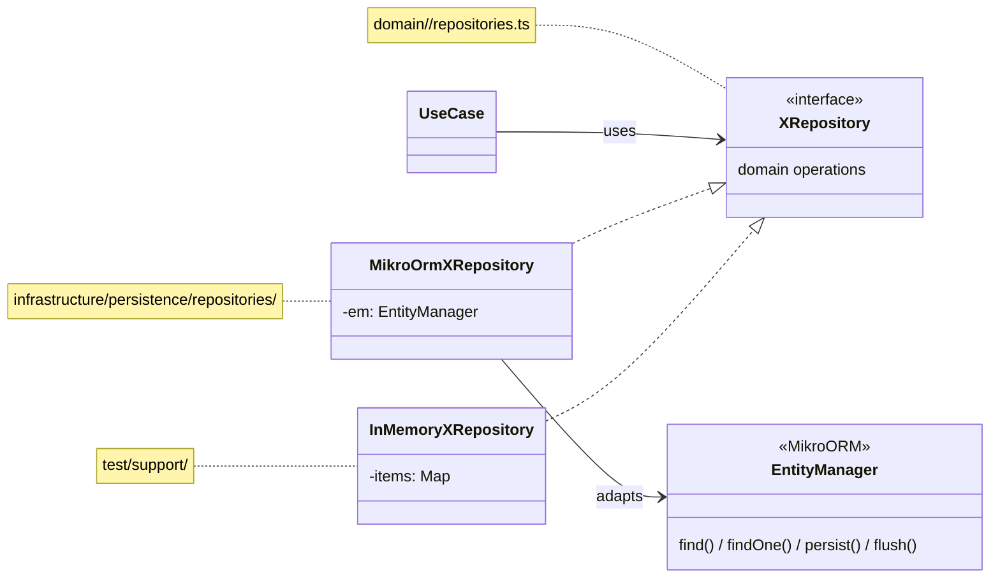
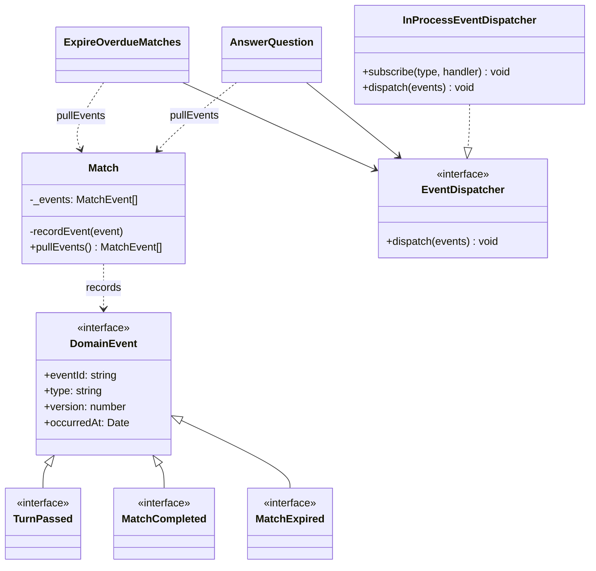
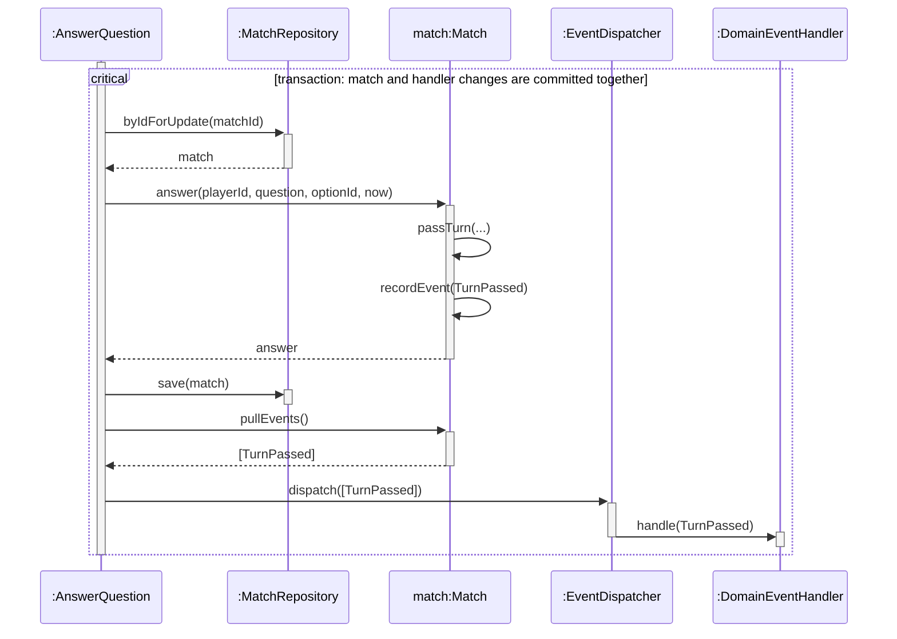
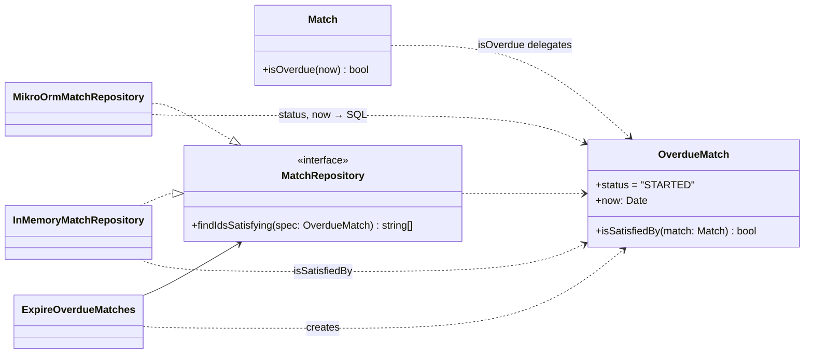

# Design Document

## 1. Project overview

**Quizduel** is a multiplayer quiz game for practising languages. Players create an account,
choose a game mode, and compete in matches by answering questions by category and difficulty. The
game supports four modes: Solo (random opponent), Solo with Friend, Teams, and Tournament. Players
earn scores, badges and daily quest rewards, and can invite friends, form teams and share results.
Players do not need to be online at the same time as their opponent: a match is played in turns,
and each player has a deadline for their turn.

Implemented so far (iteration 1): a 1vs1 match against a random opponent, with categories,
questions, turn deadlines and match expiry.

| Concern  | Choice                                                          |
| -------- | --------------------------------------------------------------- |
| Frontend | React SPA (TanStack Router and Query, PrimeReact)               |
| Backend  | Hono on Bun, TypeScript                                         |
| Database | PostgreSQL, mapped with MikroORM (`EntitySchema`)               |
| Cache    | Redis / Valkey (planned, for live match state and leaderboards) |

---

## 2. Domain discovery and modeling

### 2.1 EventStorming

> Full board: [`docs/Eventstorming.pdf`](./Eventstorming.pdf)

The EventStorming board follows a player from creating an account to the end of a match. It
splits the domain into five bounded contexts:

| Bounded context | Aggregate(s)                  | Main events                                                                                                                                                       |
| --------------- | ----------------------------- | ----------------------------------------------------------------------------------------------------------------------------------------------------------------- |
| Account/Profile | Player Profile                | account created, user logged in, language chosen                                                                                                                  |
| Matchmaking     | Lobby, Invitation, Tournament | game mode selected, random opponent found, friend accepted challenge, team formed, games assigned, tournament ended                                               |
| Match           | Match                         | match started, difficulty level chosen, round started, category chosen, question answered, question time expired, round completed, match completed, match expired |
| Gamification    | Rewards                       | score calculated, leaderboard changed, badge earned, daily quest completed, reward claimed                                                                        |
| Social          | Player Invitation             | results were shared, friend invited, friend accepted, friend request expired                                                                                      |

The policies on the board connect the contexts and describe the rules of a match:

- _When a game mode is selected,_ Matchmaking starts the search, the challenge or the team
  formation; once players are found, a match is started.
- _When a category is chosen,_ the opponent gets a "question ready" notification (external
  notification provider).
- _When a round is left,_ the next round starts; otherwise the match is completed.
- _When the turn deadline passed,_ the match expires.
- _When a match is completed,_ Gamification calculates the score and updates daily quests and
  badges; in a tournament, the next match or phase is started.
- _When a friend request is not accepted within 48 h,_ it expires.

### 2.2 Domain model

> Full diagram: [`docs/DomainModel.pdf`](./DomainModel.pdf) (source:
> [`DomainModel.drawio`](./DomainModel.drawio))

The model has one package per bounded context from 2.1, plus a **Catalog** package for the
questions, which several contexts read.

- **Account / Profile:** a **Player** has a username, email and country, learns **Language**s and
  has friends. It can calculate its total score and invite other players.
- **Matchmaking:** a **Lobby** holds the chosen game mode (`SOLO_RANDOM`, `SOLO_FRIEND`, `TEAMS`,
  `TOURNAMENT`), the play mode (`TURN_BASED`, `REAL_TIME`) and its status (`SEARCHING`, `READY`,
  `STARTED`). A **MatchInvitation** is a `CHALLENGE` (1vs1) or `TEAM` invitation. A **Team** groups
  players. A **Tournament** has a phase (`REGISTRATION`, `GROUP_PHASE`, `ELIMINATION`, `ENDED`) and
  owns its **TournamentGroup**s and **EliminationRound**s.
- **Quiz Match:** a **Match** has a game mode, play mode, difficulty and status (`UPCOMING`,
  `STARTED`, `COMPLETED`, `EXPIRED`). It consists of **Round**s, each with a deadline and the time
  its question was shown. A **PlayerAnswer** records the time a player needed and whether the
  answer was correct. A **PlayerConnection** tracks whether a player is online in a real-time
  match.
- **Catalog:** a **Category** contains **Question**s. A question has a text, difficulty and time
  limit, and exactly four **AnswerOption**s, one of them correct.
- **Gamification:** a **Score** records the points of a player in a match. **Reward** is
  abstract, with the subclasses **Badge** and **DailyQuest**. **RewardProgress** tracks a player's
  progress towards a reward.
- **Social:** a **FriendRequest** has a status and an expiry date; a **SocialShare** records
  results shared on another platform.

**Why these decisions?**

- **`Match` is the aggregate root of `Round` and `PlayerAnswer`.** Rounds and answers only change
  through the match, so it can enforce whose turn it is and the deadline.
- **`Catalog` as its own package.** Questions and categories are read by the match, but they are
  maintained independently of any match.
- **`Reward` is abstract.** `Badge` and `DailyQuest` share name, description and condition; only
  their specific attributes differ.
- **`RewardProgress` as a separate class.** It sits between `Player` and `Reward` and tracks
  progress and claiming without changing either class.
- **`MatchInvitation` separate from `FriendRequest`.** Game invitations and friend requests have
  different lifecycles.
- **`Tournament` owns `TournamentGroup` and `EliminationRound`.** The two phases have different
  structures, so each is its own owned object.
- **`PlayMode` and `PlayerConnection`** were added for the change scenario in 4.1.

---

## 3. High-level architecture

> Full diagram: [`docs/ComponentDiagram.pdf`](./ComponentDiagram.pdf) (source:
> [`ComponentDiagram.drawio`](./ComponentDiagram.drawio))

The system is divided into four subsystems:

1. **Client:** the `React Web App (SPA)` talks to the backend over REST/HTTP, and over WebSocket
   for real-time matches.
2. **Server / API:** the `Backend API Server (Hono / Bun)`, one deployable with one module per
   bounded context (the "services" in the diagram), plus the `Real-Time Gateway` (see 4.1).
3. **Persistence & Cache:** the `Main Database` (PostgreSQL) and the `In-Memory Cache`
   (Redis / Valkey), both used through interfaces.
4. **External systems:** an `Identity Provider` for login and a `Notification Provider` for push
   notifications.

| Module            | Responsibilities                                                                                          |
| ----------------- | --------------------------------------------------------------------------------------------------------- |
| Account / Profile | Create account, login, choose language. Aggregate: Player Profile.                                        |
| Matchmaking       | Game mode and play mode, player search, team formation, tournaments. Aggregate: Lobby.                    |
| Match / Gameplay  | Round play, question catalog, match control (start, expire, complete), turn-based and real-time policies. |
| Gamification      | Score and leaderboard, badges, daily quests, rewards.                                                     |
| Social            | Friends, results sharing, friend invitation notifications.                                                |
| Real-Time Gateway | Live match session (WebSocket), presence and reconnection.                                                |

| From              | To                    | Trigger                           |
| ----------------- | --------------------- | --------------------------------- |
| Account / Profile | Matchmaking           | user logged in → select game mode |
| Matchmaking       | Match / Gameplay      | match created                     |
| Match / Gameplay  | Gamification          | match completed → calculate score |
| Real-Time Gateway | Match / Gameplay      | answer received in a live match   |
| Match, Social     | Notification Provider | question ready; friend invited    |
| Account / Profile | Identity Provider     | login, create account             |

The API is layered (see [architecture.md](architecture.md)); the modules are folders inside the
layers (e.g. `domain/match`, `domain/matchmaking`).

**Why these decisions?**

- **One module per bounded context, in one deployable.** Each module has one domain concern from
  the EventStorming, without the network calls and deployment of separate services.
- **Database and cache behind interfaces.** The storage technology can change without changing
  the modules.
- **Hono / Bun and React.** One language (TypeScript) in the frontend and the backend. Use Hono only in the http module, keep the domain module free from any frameworks.

---

## 4. Future change scenarios

### 4.1 Real-time play

> **"Players can play against each other in real time, not only in alternating rounds."**

#### 4.1.1 Context

Today, each player plays at their own time and gets a notification when it is their turn. In the
new scenario, a second play mode is added: **real time**.

- Players are online at the same time.
- Everyone sees the same question at the same moment, with a timer controlled by the server.
- When everyone has answered, or the time is over, the result is shown and the next question
  starts.
- If a player stays offline for too long, the match expires.

The **turn-based mode stays**, because players do not need to be online at the same time as their
opponent.

**Why this change is plausible.**

- It is a common feature in quiz apps. Users usually ask for it after the asynchronous mode
  already exists.
- It keeps the goal of the product (practising languages by playing against other people).
- It uses well-known technology (WebSocket).

**Parts of the system affected.**

| Part                                        | Impact                               |
| ------------------------------------------- | ------------------------------------ |
| Domain (`Lobby`, `Match`, `Round`)          | Small: new attributes                |
| Domain (player connection)                  | Medium: new class `PlayerConnection` |
| Client (React Web App)                      | Medium: live connection and timer    |
| Match / Gameplay Service                    | Small: new policies                  |
| Matchmaking Service                         | Small: choice of play mode           |
| Live connection handling                    | New                                  |
| Notification, Gamification, Social, Account | None                                 |

**Situation before the change.** The Match / Gameplay Service contains match control (start,
expire, complete), round play (choose category, show question, save answer) and the policies
(start the next round, expire when the deadline passes). The Matchmaking Service creates the
match; the Match Service notifies the opponent and calls the Gamification Service when the match
ends. Its cohesion is high: it only handles matches (functional cohesion). However, all policies
assume turns and notifications.

**Alternatives analysed.**

- **A. Everything in the Match Service.** The Match Service itself opens WebSocket connections,
  controls live timers and detects presence.
- **B. New Real-Time Gateway component + `PlayMode` in the domain.** A dedicated component handles
  the live connection. The Match Service keeps the rules and only gets new policies for real-time
  mode.
- **C. Separate service for real-time matches.** A full "Real-Time Match Service" with its own
  rules and model, next to the current Match Service.

#### 4.1.2 Coupling and cohesion

The analysis follows Khononov.

**Integrations per alternative.**

- **A. Everything in the Match Service.**
  - _A1, real-time policies ↔ match rules:_ the new policies (all answered → next question,
    offline too long → expire) work on the same rules as the turn-based ones and sit in the same
    component.
  - _A2, match rules ↔ WebSocket and presence:_ the game rules and the connection handling share
    almost no knowledge, but now live in the same component.
- **B. Real-Time Gateway + `PlayMode`.**
  - _B1, real-time policies ↔ match rules:_ as in A1, the policies sit in the Match module next to
    the rules they use.
  - _B2, Gateway → Match Service:_ the Gateway only calls the Match module's use cases and listens
    to its domain events. WebSocket and presence stay inside the Gateway.
- **C. Separate real-time service.**
  - _C1, real-time service ↔ turn-based service:_ both implement score, rounds and end of match,
    so the same rules exist in two services.
  - _C2, both services ↔ database and cache:_ both write the same match data.
  - _C3, Matchmaking → both services:_ Matchmaking creates a match in one of the two services
    through its interface.

| Integration                         | Strength                      | Distance         | Volatility | Result                    |
| ----------------------------------- | ----------------------------- | ---------------- | ---------- | ------------------------- |
| A1 Real-time policies ↔ match rules | functional                    | same component   | high       | Balanced (cohesion)       |
| A2 Match rules ↔ WebSocket/presence | low (little shared knowledge) | same component   | rules high | **Local complexity**      |
| B1 Real-time policies ↔ match rules | functional                    | same component   | high       | Balanced (cohesion)       |
| B2 Gateway → Match Service          | contract                      | other module     | low        | Balanced (loose coupling) |
| C1 Real-time ↔ turn-based service   | functional (duplicated rules) | separate service | high       | **Global complexity**     |
| C2 Both services ↔ database/cache   | intrusive (same tables)       | separate service | high       | **Global complexity**     |
| C3 Matchmaking → both services      | contract                      | separate service | low        | Balanced (loose coupling) |

**Summary.**

| Criterion                     | A                        | B        | C                          |
| ----------------------------- | ------------------------ | -------- | -------------------------- |
| Balance                       | Local complexity (A2)    | Balanced | Global complexity (C1, C2) |
| Testing rules without network | Hard                     | Good     | Medium                     |
| Effort                        | Low at first, high later | Medium   | High                       |
| Risk to what already exists   | High                     | Low      | Low                        |

#### 4.1.3 Decision and consequences

> **Alternative B was chosen:** create the **Real-Time Gateway** component and add the
> **`PlayMode`** concept (`TURN_BASED` or `REAL_TIME`) to the domain.

**Justification.**

1. **Strong coupling stays close (B1).** The real-time policies share the match rules and live
   next to them in the Match module.
2. **Weak coupling across the distance (B2).** The Gateway only uses the Match module's use cases
   and events, and the Match module does not know WebSocket. A change of transport technology only
   affects the Gateway.
3. **No duplicated rules.** Score, rounds and end of match stay in one component. The
   Gamification Service is still called only by the Match Service.
4. **Turn-based mode is protected.** Notifications, deadlines and match expiration do not change.

**Accepted costs.**

- One more component to maintain and monitor.
- The Match Service now has two families of policies (turn-based and real-time). If they grow,
  they can be split into strategies in the code.
- Reconnection and network failures must be handled, which was not needed before.

**Open points.**

- Rule for a speed-based score (the `timeNeeded` attribute of `PlayerAnswer` already allows it,
  but the rule is not defined).
- Maximum offline time before the match expires.
- Behaviour when the connection drops: expire the match or go back to turn-based mode.

**Effect on the diagrams.**

| Decision                                                  | Where it appears                                     |
| --------------------------------------------------------- | ---------------------------------------------------- |
| `PlayMode` in `Lobby` and `Match`                         | `DomainModel.drawio`                                 |
| `PlayerConnection` and `ConnectionStatus`                 | `DomainModel.drawio`                                 |
| Real-Time Gateway, `WebSocket` interface and dependencies | `ComponentDiagram.drawio`                            |
| `async:` and `real-time:` policies                        | `ComponentDiagram.drawio` (Match / Gameplay Service) |

**Implementation status: open.**

### 4.2 New question types

> **"Players practise a language with different kinds of questions, not only by choosing one of
> four options."**

#### 4.2.1 Context

Today every question is multiple choice: a text and four options, one of them correct. In the new
scenario, more **answer kinds** are added:

- **Multiple choice** (as today): choose one of the options.
- **Typed answer:** type the translation; several spellings can be accepted.
- **Word order:** put the given words in the right order to form a sentence.

Timer, rounds, score and turn-based play **do not change**. A round can mix kinds.

**Why this change is plausible.**

- The product is about practising languages. Choosing from options trains recognition only;
  typing and ordering words train active recall and grammar.
- Language apps usually offer all of these, and more kinds follow (listening, matching pairs).

**Parts of the system affected.**

| Part                                           | Impact                                            |
| ---------------------------------------------- | ------------------------------------------------- |
| Catalog (`Question`, `AnswerOption`)           | High: the answer rules depend on the kind         |
| Match (`Match.answer`, `PlayerAnswer`)         | Small: the given answer is no longer an option id |
| Application (`ShowQuestion`, `AnswerQuestion`) | Medium: question view and solution per kind       |
| Persistence, seed and HTTP API                 | Medium: new columns and answer body               |
| Client (React Web App)                         | High: one input and feedback view per kind        |
| Matchmaking, Gamification, Social, Account     | None                                              |

**Situation before the change.**

Every question is multiple (single) choice: a `Question` has exactly four
`AnswerOption`s, one of them correct. The question decides whether an answer is correct:
[`isCorrectAnswer`](../apps/api/src/domain/catalog/question.ts#L42-L53) checks that the chosen
option is the correct one and that it was given within the time limit. The Match asks the question
and does not look at the content of the answer. A given answer is the id of the chosen option
(`optionId`). It is sent by the [client](../apps/web/src/components/match/question-card.tsx#L50-L60),
passed through the API and the use case to
[`Match.answer`](../apps/api/src/domain/match/match.ts#L206-L225), and stored in
[`PlayerAnswer`](../apps/api/src/domain/match/player-answer.ts#L6). After answering, the client is
told the id of the correct option.

**Alternatives analysed.**

- **A. Type field and conditionals.** `Question` gets a `type` and nullable fields per kind; every
  place that needs the kind uses `switch (question.type)`.
- **B. Answer kinds as objects (Strategy).** `Question` _has_ an `AnswerKind` (`MultipleChoice`,
  `TypedAnswer`, `WordOrder`) that checks an answer and builds its view and solution. A
  `GivenAnswer` value object replaces `optionId`; `Question` keeps the time rule.
- **C. Subclasses of `Question`.** One subclass per kind.

#### 4.2.2 Coupling and cohesion

The analysis follows Khononov, as in 4.1.

**Current state.**

- _`Match` → `Question`:_ the Match only asks the question whether an answer is correct, so the
  match rules are already independent of the kind.
- _`optionId` ↔ every layer:_ "an answer is the id of one of four options" is a primitive that
  travels from the client through API, use case and Match into the database (_Primitive
  Obsession_, Fowler, _Refactoring_). Every layer depends on the multiple-choice kind.
- _`isCorrectAnswer`:_ mixes the time limit (a game rule, the same for every kind) with the option
  check (a rule of the kind).

**Integrations per alternative.**

- **A. Type field and conditionals.**
  - _A1, `Question` ↔ rules of all kinds:_ the kinds share almost nothing, but sit in one class.
  - _A2, `switch` places ↔ set of kinds:_ use cases, API and client each must know every kind; a
    new kind changes all of them (_Repeated Switches_, Fowler).
- **B. Answer kinds as objects.**
  - _B1, `AnswerKind` ↔ its own rules:_ check, view and solution of a kind are in one class.
  - _B2, `Match` → `Question`:_ the Match passes the `GivenAnswer` on without looking into it.
- **C. Subclasses of `Question`.**
  - _C1, subclass ↔ base `Question`:_ each subclass inherits state and the time rule.
  - _C2, class hierarchy ↔ ORM mapping:_ every subclass needs its own mapping and columns.

In every alternative the client needs one input view per kind; this is the feature itself.

| Integration                        | Strength                      | Distance             | Volatility | Result                    |
| ---------------------------------- | ----------------------------- | -------------------- | ---------- | ------------------------- |
| A1 `Question` ↔ rules of all kinds | low (little shared knowledge) | same class           | high       | **Local complexity**      |
| A2 `switch` places ↔ set of kinds  | functional                    | other layers, client | high       | **Global complexity**     |
| B1 `AnswerKind` ↔ its own rules    | functional                    | same class           | high       | Balanced (cohesion)       |
| B2 `Match` → `Question`            | contract                      | other module         | low        | Balanced (loose coupling) |
| C1 Subclass ↔ base `Question`      | intrusive (inherited state)   | same module          | high       | Balanced, but rigid       |
| C2 Class hierarchy ↔ ORM mapping   | model                         | infrastructure       | high       | **Unbalanced**            |

**Summary.**

| Criterion                        | A                                    | B                      | C                     |
| -------------------------------- | ------------------------------------ | ---------------------- | --------------------- |
| Balance                          | Local and global complexity (A1, A2) | Balanced               | Unbalanced (C2)       |
| Adding a kind                    | Change every `switch`                | One class, client view | Subclass and mapping  |
| Second axis (prompt: text/audio) | More `switch`es                      | Second object          | Class per combination |
| Risk to multiple choice          | High                                 | Low                    | Medium                |

#### 4.2.3 Decision and consequences

> **Alternative B was chosen:** answer kinds as objects (_Strategy_, GoF) and a `GivenAnswer`
> value object (Evans) instead of `optionId`.

**Justification.**

1. **Strong coupling stays close (B1).** Everything about a kind is in one class.
2. **Weak coupling across the distance (B2).** A new kind does not touch the Match, its events or
   the use cases.

**Accepted costs.**

- More small classes, and a kind-specific answer format shared between API and client.
- The client still changes for every kind.
- Typed answers can be rejected for a missing spelling; the catalog must list common variants.

**Effect on the diagrams.**

| Decision                                                                                       | Where it appears                                     |
| ---------------------------------------------------------------------------------------------- | ---------------------------------------------------- |
| `Question` ◆ 1 `AnswerKind` (interface) with `MultipleChoice`, `TypedAnswer`, `WordOrder`      | `DomainModel.drawio` (Catalog)                       |
| `AnswerOption` (4) owned by `MultipleChoice` instead of `Question`                             | `DomainModel.drawio` (Catalog)                       |
| `GivenAnswer` value object in `PlayerAnswer`; association `selected` to `AnswerOption` removed | `DomainModel.drawio` (Quiz Match)                    |
| `Match.answer(AnswerOption)` becomes `Match.answer(GivenAnswer)`                               | `DomainModel.drawio` (Quiz Match)                    |
| Question Catalog: question kinds (choice, typed, word order)                                   | `ComponentDiagram.drawio` (Match / Gameplay Service) |

No new component and no new dependency: the change stays inside the Match / Gameplay Service and
the client.

**Implementation status: open.**

---

## 5. Existing design pattern instances

### 5.1 Storing aggregates without depending on the ORM — Repository implemented as an Adapter

#### Problem in context

The use cases have to load, find, lock and save the aggregates of three bounded contexts:
`Category` and `Question` (catalog), `Lobby` (matchmaking) and `Match` (match). Each aggregate also has its own queries, and each query has to be named in domain terms, for example "the oldest open lobby", "random questions that fit the round" and "matches whose turn deadline has passed". Finally, the
use cases have to be testable without a database.

#### The pattern: selection and implementation

**Pattern and rationale.** _Repository_ (Evans, DDD ch. 6): an object that looks like a collection of aggregates and hides how they are stored. Its interface is part of the domain. The implementation is an _Adapter_ (GoF, object adapter): it makes the MikroORM
`EntityManager` (the adaptee) fit the interface the domain expects (the target). We chose it because the domain then names the operations it needs, and only the adapter knows how they are
done in the database. A second adapter keeps the aggregates in memory for the tests.

**Mapping to the implementation.**

| Pattern role                  | Concrete implementation                                                                                                                                                                                                                                                                                                                                                                                                                                                                                | Explanation                                                                                                                   |
| ----------------------------- | ------------------------------------------------------------------------------------------------------------------------------------------------------------------------------------------------------------------------------------------------------------------------------------------------------------------------------------------------------------------------------------------------------------------------------------------------------------------------------------------------------ | ----------------------------------------------------------------------------------------------------------------------------- |
| Target (Repository interface) | [`CategoryRepository`](../apps/api/src/domain/catalog/repositories.ts#L19), [`QuestionRepository`](../apps/api/src/domain/catalog/repositories.ts#L5), [`LobbyRepository`](../apps/api/src/domain/matchmaking/repositories.ts#L4), [`MatchRepository`](../apps/api/src/domain/match/repositories.ts#L4)                                                                                                                                                                                                | One interface per aggregate, in the aggregate's bounded context. Category and Question are read-only, so they have no `save`. |
| Adapter                       | [`MikroOrmCategoryRepository`](../apps/api/src/infrastructure/persistence/repositories/mikro-orm-category.repository.ts#L4), [`MikroOrmQuestionRepository`](../apps/api/src/infrastructure/persistence/repositories/mikro-orm-question.repository.ts#L4), [`MikroOrmLobbyRepository`](../apps/api/src/infrastructure/persistence/repositories/mikro-orm-lobby.repository.ts#L5), [`MikroOrmMatchRepository`](../apps/api/src/infrastructure/persistence/repositories/mikro-orm-match.repository.ts#L5) | Implements the interface by calling the ORM.                                                                                  |
| Adaptee                       | MikroORM `EntityManager`, passed to each adapter's constructor (e.g. [here](../apps/api/src/infrastructure/persistence/repositories/mikro-orm-match.repository.ts#L6))                                                                                                                                                                                                                                                                                                                                 | Knows SQL, locks and the identity map, but nothing about the domain's terms.                                                  |
| Second adapter (tests)        | [`InMemoryCategoryRepository`](../apps/api/test/support/in-memory-repositories.ts#L18), [`InMemoryQuestionRepository`](../apps/api/test/support/in-memory-repositories.ts#L26), [`InMemoryLobbyRepository`](../apps/api/test/support/in-memory-repositories.ts#L47), [`InMemoryMatchRepository`](../apps/api/test/support/in-memory-repositories.ts#L78)                                                                                                                                               | The same interfaces, implemented with `Map`s and arrays.                                                                      |
| Client                        | Use cases via the [`Repositories`](../apps/api/src/application/index.ts#L30-L36) bundle                                                                                                                                                                                                                                                                                                                                                                                                                | Only the interfaces are visible to them.                                                                                      |
| Choosing the adapter          | [`mikroOrmRepositories`](../apps/api/src/infrastructure/persistence/repositories/index.ts#L9-L17), used in [`main.ts`](../apps/api/src/main.ts#L22); tests: [`inMemoryUseCases`](../apps/api/test/support/in-memory-repositories.ts#L104)                                                                                                                                                                                                                                                              | The composition root decides which adapter the use cases get.                                                                 |

How the adapters translate the domain's operations:

| Domain operation                                                                                                                                                                                                        | Translation in the MikroORM adapter                                                                                                                                                                                                  |
| ----------------------------------------------------------------------------------------------------------------------------------------------------------------------------------------------------------------------- | ------------------------------------------------------------------------------------------------------------------------------------------------------------------------------------------------------------------------------------ |
| [`LobbyRepository.lockMatchmaking`](../apps/api/src/domain/matchmaking/repositories.ts#L9)                                                                                                                              | Postgres advisory lock [`pg_advisory_xact_lock`](../apps/api/src/infrastructure/persistence/repositories/mikro-orm-lobby.repository.ts#L12-L15), released when the transaction ends                                                  |
| [`LobbyRepository.findOpenFor`](../apps/api/src/domain/matchmaking/repositories.ts#L15)                                                                                                                                 | [Filtered query, oldest first](../apps/api/src/infrastructure/persistence/repositories/mikro-orm-lobby.repository.ts#L17-L28)                                                                                                        |
| [`QuestionRepository.pickRandom`](../apps/api/src/domain/catalog/repositories.ts#L10)                                                                                                                                   | [Query with `ORDER BY random()` and `LIMIT`](../apps/api/src/infrastructure/persistence/repositories/mikro-orm-question.repository.ts#L7-L22)                                                                                        |
| [`MatchRepository.byIdForUpdate`](../apps/api/src/domain/match/repositories.ts#L11)                                                                                                                                     | [`SELECT … FOR UPDATE`](../apps/api/src/infrastructure/persistence/repositories/mikro-orm-match.repository.ts#L12-L19) with `refresh`, so the locked row's current state is used                                                     |
| [`MatchRepository.findIdsSatisfying`](../apps/api/src/domain/match/repositories.ts#L11)                                                                                                                                 | [Query built from the `OverdueMatch` specification](../apps/api/src/infrastructure/persistence/repositories/mikro-orm-match.repository.ts#L25-L34) (see 5.3); returns raw ids, so partly loaded matches stay out of the identity map |
| `save` ([Lobby](../apps/api/src/infrastructure/persistence/repositories/mikro-orm-lobby.repository.ts#L37-L39), [Match](../apps/api/src/infrastructure/persistence/repositories/mikro-orm-match.repository.ts#L36-L38)) | `em.persist(x).flush()`                                                                                                                                                                                                              |

**Illustration:** (`X` stands for Category, Question, Lobby or Match)

#### Consequences and alternatives

- **+** The domain and the use cases do not import MikroORM. Changing the ORM or the database
  only changes the adapters.
- **+** All use case tests run on the in-memory adapters, without a database.
- **−** Each interface has two implementations, which must behave the same. The tests only run the
  in-memory one, so a wrong query in the MikroORM adapter is not caught by them.
- **−** Some rules are written in both adapters (see 5.3).

_Alternatives:_ use the `EntityManager` directly in the use cases (less code, but the
application layer then depends on the ORM and cannot be tested without a database). Also it puts persistence into the domain classes, which conflicts with a
framework-free domain.

### 5.2 Reacting to match changes without coupling to the Match — Domain Event Pattern

#### Problem in context

When the turn goes to the other player, or a match is completed or expires, other parts of the
system have to react: notify the player whose turn it is now, update statistics, badges and daily
quests. These parts belong to other bounded contexts (notifications, gamification). If `Match` or
the use cases called them directly, the match context would depend on all of them, and each new
reaction would change the match code. At the same time, their changes have to be saved together
with the change of the match, or not at all.

#### The pattern: selection and implementation

**Pattern and rationale.** _Domain Event_ (Fowler, Evans): the aggregate records that something important happened, as an immutable
object with a name in the language of the domain. We use the variant in which the aggregate only
_collects_ its events and the use case _dispatches_ them after saving. So the domain does not need a dispatcher, and the events are delivered inside
the same transaction.

**Mapping to the implementation.**

| Pattern role                | Concrete implementation                                                                                                                                                                                                                                                                                                                                                                     | Explanation                                                                                                                     |
| --------------------------- | ------------------------------------------------------------------------------------------------------------------------------------------------------------------------------------------------------------------------------------------------------------------------------------------------------------------------------------------------------------------------------------------- | ------------------------------------------------------------------------------------------------------------------------------- |
| Event contract              | [`DomainEvent`](../apps/api/src/domain/shared/events/domain-event.ts#L8); [`TurnPassed`](../apps/api/src/domain/shared/events/match-events.ts#L7), [`MatchCompleted`](../apps/api/src/domain/shared/events/match-events.ts#L19), [`MatchExpired`](../apps/api/src/domain/shared/events/match-events.ts#L32), union [`MatchEvent`](../apps/api/src/domain/shared/events/match-events.ts#L42) | `eventId`, `type`, `version`, `occurredAt` plus event data. Kept outside the Match context, so subscribers do not depend on it. |
| Publisher (aggregate)       | [`Match.recordEvent`](../apps/api/src/domain/match/match.ts#L350-L353), called in [`expireIfOverdue`](../apps/api/src/domain/match/match.ts#L240), [`completeRound`](../apps/api/src/domain/match/match.ts#L306) and [`passTurn`](../apps/api/src/domain/match/match.ts#L327)                                                                                                               | The match decides _what_ happened; it gives each event its `eventId`.                                                           |
| Collected events            | [`_events`](../apps/api/src/domain/match/match.ts#L27), [`pullEvents`](../apps/api/src/domain/match/match.ts#L300)                                                                                                                                                                                                                                                                          | Not persisted. `pullEvents` empties the list, so each event is dispatched only once.                                            |
| Dispatcher interface (port) | [`EventDispatcher`](../apps/api/src/application/event-dispatcher.ts#L8-L10)                                                                                                                                                                                                                                                                                                                 | In the application layer, so the domain has no dependency on it.                                                                |
| Dispatch point              | [`AnswerQuestion`](../apps/api/src/application/answer-question.ts#L33-L35), [`ExpireOverdueMatches`](../apps/api/src/application/expire-overdue-matches.ts#L28-L29)                                                                                                                                                                                                                         | After `save`, inside the transaction.                                                                                           |
| Dispatcher                  | [`InProcessEventDispatcher`](../apps/api/src/infrastructure/events/in-process-event-dispatcher.ts#L11): [`subscribe`](../apps/api/src/infrastructure/events/in-process-event-dispatcher.ts#L14), [`dispatch`](../apps/api/src/infrastructure/events/in-process-event-dispatcher.ts#L23)                                                                                                     | Handlers per event type, called one after another in subscription order.                                                        |
| Handler                     | [`DomainEventHandler`](../apps/api/src/infrastructure/events/in-process-event-dispatcher.ts#L4); subscriptions in [`main.ts`](../apps/api/src/main.ts#L16-L20)                                                                                                                                                                                                                              | A function; for now the handlers only log. Notifications and gamification will subscribe here.                                  |

**Illustration:** structure. Neither `Match` nor the events depend on `EventDispatcher`; only the
use cases do, and only the infrastructure implements it.

Behaviour: answering the last question of a turn

#### Consequences and alternatives

- **+** `Match` does not know who reacts to it. A new reaction is a new subscription in the
  composition root; the match code does not change.
- **+** The events are a versioned contract ([architecture.md](architecture.md#domain-events)), so other
  contexts depend on them, not on `Match`.
- **+** Everything a handler writes is committed together with the match. If a handler throws, the
  whole change is rolled back.
- **−** Handlers run synchronously in the request. They must be fast, and a failing handler makes
  the player's move fail.
- **−** Every use case that changes a match has to call `dispatch(match.pullEvents())` after
  `save`. If one forgets it, the events are lost without an error.
- **−** External systems (e-mail, push) must not be called from a handler, because the
  transaction can still roll back afterwards.

_Alternatives:_ direct calls from the use cases (simple, but couples the match context to every
receiver). A static `DomainEvents.raise()` inside the domain makes the domain depend on a global dispatcher. A _Transactional Outbox_
(Richardson, _Microservices Patterns_) stores the events in the same transaction and delivers
them afterwards. It is the next step once a handler has to call an external system.

### 5.3 One rule for overdue matches, in the domain and in the database — Specification

#### Problem in context

The expiry job needs every overdue match from the database, and the match itself has to reject
moves after the deadline. Both must use the same rule: "a running match whose turn deadline has
passed". Before, this rule was written twice: in the domain, in `Match.isOverdue`
(`status === "STARTED" && deadline !== null && now >= deadline`), and as a copy in SQL, in the
MikroORM repository's `findOverdueIds` (`{ _status: "STARTED", _turnDeadline: { $lte: now } }`).
This is _Duplicated Code_ (Fowler, _Refactoring_, ch. 3): the same knowledge written down twice.

- A change of the rule (e.g. a grace period, paused matches, or another rule for a real-time
  `PlayMode`, see 4.1) had to be made in two places.
- The tests could not catch a forgotten SQL change, because they use the in-memory repository,
  which called the domain rule.
- If the SQL finds _too many_ matches, nothing goes wrong: `ExpireOverdueMatches` checks each match
  again after locking it
  ([`expireIfOverdue`](../apps/api/src/application/expire-overdue-matches.ts#L26)). If it finds
  _too few_, those matches never expire, and nothing reports it.

#### The pattern: selection and implementation

**Pattern and rationale.** _Specification_ (Evans, Fowler):
the rule becomes an object of its own with `isSatisfiedBy(candidate)`. It can be used to check one
object and to select objects from a repository. The rule is now written only in `OverdueMatch`.
The match checks itself with it, the in-memory repository filters with it, and the database
repository turns its criteria (`status`, `now`) into the query. The repository method takes the
specification instead of a date, so the rule a caller selects by is visible in its signature.
There is only one specification so far, so there is no general `Specification<T>` interface yet.
It can be added when the next rule (see "Remaining" below) becomes a specification.

**Mapping to the implementation.**

| Pattern role                | Concrete implementation                                                                                                                      | Explanation                                                                                                                                                                                                        |
| --------------------------- | -------------------------------------------------------------------------------------------------------------------------------------------- | ------------------------------------------------------------------------------------------------------------------------------------------------------------------------------------------------------------------ |
| Specification               | [`OverdueMatch`](../apps/api/src/domain/match/overdue-match.ts#L10-L24)                                                                      | A value object holding the moment (`now`) and the required `status`.                                                                                                                                               |
| `isSatisfiedBy`             | [`OverdueMatch.isSatisfiedBy`](../apps/api/src/domain/match/overdue-match.ts#L17-L23)                                                        | The only place the rule is written.                                                                                                                                                                                |
| Candidate                   | [`Match`](../apps/api/src/domain/match/match.ts#L26) via its getters `status` and `turnDeadline`                                             |                                                                                                                                                                                                                    |
| Check of one object         | [`Match.isOverdue`](../apps/api/src/domain/match/match.ts#L121-L123)                                                                         | Delegates to the specification; it is used to reject moves ([`requirePlayableRound`](../apps/api/src/domain/match/match.ts#L375)) and to expire ([`expireIfOverdue`](../apps/api/src/domain/match/match.ts#L241)). |
| Selection from a repository | [`MatchRepository.findIdsSatisfying`](../apps/api/src/domain/match/repositories.ts#L11)                                                      | Takes the specification instead of a date.                                                                                                                                                                         |
| Selection in memory         | [`InMemoryMatchRepository.findIdsSatisfying`](../apps/api/test/support/in-memory-repositories.ts#L94-L96)                                    | Uses `isSatisfiedBy` directly.                                                                                                                                                                                     |
| Translation into a query    | [`MikroOrmMatchRepository.findIdsSatisfying`](../apps/api/src/infrastructure/persistence/repositories/mikro-orm-match.repository.ts#L25-L34) | Builds `status = 'STARTED' AND turn_deadline <= now` from the specification's fields. A `NULL` deadline never matches `<=`, which covers the null check.                                                           |
| Client                      | [`ExpireOverdueMatches`](../apps/api/src/application/expire-overdue-matches.ts#L15)                                                          | `findIdsSatisfying(new OverdueMatch(this.now()))`                                                                                                                                                                  |

**Illustration:**

#### Consequences and alternatives

- **+** The rule exists once in the domain. Changing it means changing `OverdueMatch` and, if the
  criteria change, its translation in one adapter.
- **+** The rule has a name and its own tests, independent of the match flow.
- **−** The translation into SQL still has to match `isSatisfiedBy`. A test against Postgres would
  make this safe.
- **−** One more class, and the repository interface depends on it.

_Alternatives:_ documenting the SQL as a prefilter that may find too many but never too few
(the rule would still exist twice), and a contract test that runs the same cases against the
Postgres repository and against the domain.

_Remaining:_ three more rules are still written in several places (see 6.1).

## 6. Existing code smells and possible refactorings

### 6.1 Duplicated Code — selection rules in the repository adapters

**Location and evidence.** The same smell as in 5.3: a rule for selecting aggregates is written in
each repository adapter instead of once in the domain (_Duplicated Code_).

| Rule                                                                       | Written in                                                                                                                                                                                                                                                                                                                                              |
| -------------------------------------------------------------------------- | ------------------------------------------------------------------------------------------------------------------------------------------------------------------------------------------------------------------------------------------------------------------------------------------------------------------------------------------------------- |
| Lobby "open for a player": searching, same mode, player not in it yet      | [`MikroOrmLobbyRepository.findOpenFor`](../apps/api/src/infrastructure/persistence/repositories/mikro-orm-lobby.repository.ts#L17-L28), [`InMemoryLobbyRepository.findOpenFor`](../apps/api/test/support/in-memory-repositories.ts#L57-L63), guards of [`Lobby.join`](../apps/api/src/domain/matchmaking/lobby.ts#L58-L64)                              |
| Lobby "the player is searching": searching, player in it                   | [`MikroOrmLobbyRepository.findSearchingBy`](../apps/api/src/infrastructure/persistence/repositories/mikro-orm-lobby.repository.ts#L30-L35), [`InMemoryLobbyRepository.findSearchingBy`](../apps/api/test/support/in-memory-repositories.ts#L65-L71)                                                                                                     |
| Question "fits the round": category, difficulty, not used yet in the match | [`MikroOrmQuestionRepository.pickRandom`](../apps/api/src/infrastructure/persistence/repositories/mikro-orm-question.repository.ts#L7-L22), [`InMemoryQuestionRepository.pickRandom`](../apps/api/test/support/in-memory-repositories.ts#L29-L40); [`Match.chooseCategory`](../apps/api/src/domain/match/match.ts#L163-L176) checks only "not used yet" |

**Design consequences.**

- A change of a rule (e.g. matching by skill level) has to be made in every place.
- The tests use the in-memory repositories, so they cannot catch an SQL query that drifts apart.
- The domain does not check what the repositories return: the match accepts questions of another
  category or difficulty, and a wrongly found lobby makes `Lobby.join` throw instead of opening a
  new lobby.

**Possible refactoring.** _Specification_ (Evans & Fowler, "Specifications"), as `OverdueMatch` in
5.3: one object per rule (`OpenLobbyFor`, `SearchingLobbyOf`, `QuestionFitsRound`). The domain
checks with `isSatisfiedBy`, the in-memory repository filters with it, and the MikroORM repository
translates it into the query. With three specifications, a common `Specification<T>` interface
becomes worthwhile.

**Implementation status: open.**

## Deliverables Iteration 1

| Artifact                         | Location                       |
| -------------------------------- | ------------------------------ |
| This design document             | `docs/design.md`               |
| Domain model (UML class diagram) | `docs/DomainModel.pdf`         |
| Domain model (draw.io XML)       | `docs/DomainModel.drawio`      |
| Component diagram (draw.io XML)  | `docs/ComponentDiagram.drawio` |
| Component diagram (PDF)          | `docs/ComponentDiagram.pdf`    |

## Deliverables Iteration 0

| Artifact                         | Location                                                                                                            |
| -------------------------------- | ------------------------------------------------------------------------------------------------------------------- |
| This design document             | [`docs/design.md`](https://github.com/thielpa/DOO-2627/blob/iteration-0/docs/design.md)                             |
| Domain model (UML class diagram) | [`docs/DomainModel.pdf`](https://github.com/thielpa/DOO-2627/blob/iteration-0/docs/DomainModel.pdf)                 |
| Domain model (draw.io XML)       | [`docs/DomainModel.drawio`](https://github.com/thielpa/DOO-2627/blob/iteration-0/docs/DomainModel.drawio)           |
| Component diagram (draw.io XML)  | [`docs/ComponentDiagram.drawio`](https://github.com/thielpa/DOO-2627/blob/iteration-0/docs/ComponentDiagram.drawio) |
| Component diagram (PDF)          | [`docs/ComponentDiagram.pdf`](https://github.com/thielpa/DOO-2627/blob/iteration-0/docs/ComponentDiagram.pdf)       |
| Event Storming source            | [`docs/Eventstorming.pdf`](https://github.com/thielpa/DOO-2627/blob/iteration-0/docs/Eventstorming.pdf)             |
