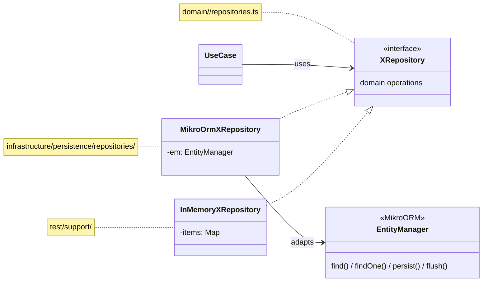
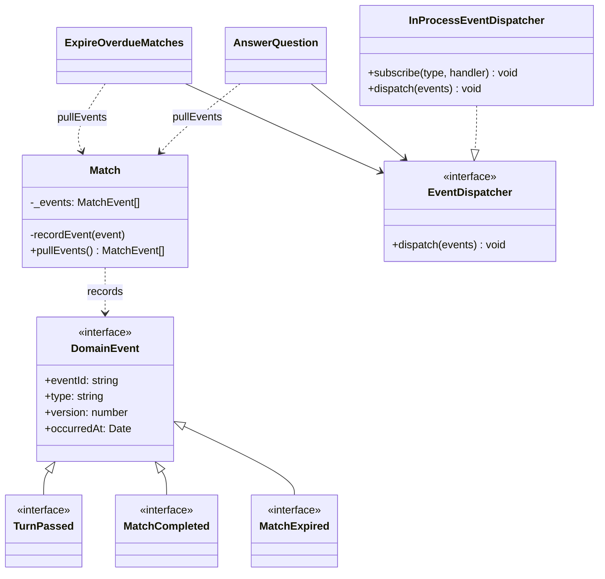
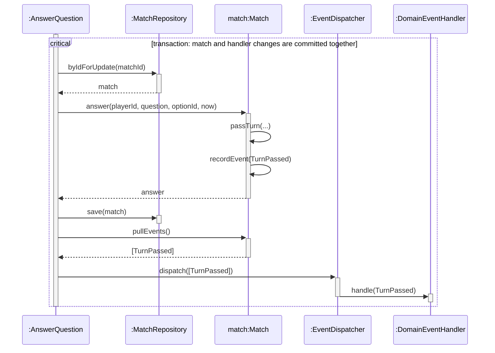
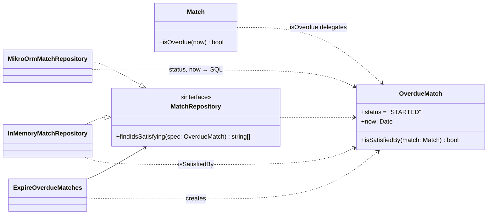

# Design Document

## 1. Project overview

**Quizduel** is a multiplayer quiz game for practising languages. Players create an account,
choose a game mode, and compete in matches by answering questions by category and difficulty. The
game supports four modes: Solo (random opponent), Solo with Friend, Teams, and Tournament. Players
earn scores, badges and daily quest rewards, and can invite friends, form teams and share results.
Players do not need to be online at the same time as their opponent: a match is played in turns,
and each player has a deadline for their turn.

Implemented so far (iteration 1): a 1vs1 match against a random opponent, with categories,
questions, turn deadlines and match expiry.

| Concern  | Choice                                                          |
| -------- | --------------------------------------------------------------- |
| Frontend | React SPA (TanStack Router and Query, PrimeReact)               |
| Backend  | Hono on Bun, TypeScript                                         |
| Database | PostgreSQL, mapped with MikroORM (`EntitySchema`)               |
| Cache    | Redis / Valkey (planned, for live match state and leaderboards) |

---

## 2. Domain discovery and modeling

### 2.1 EventStorming

> Full board: [`docs/Eventstorming.pdf`](./Eventstorming.pdf)

The EventStorming board follows a player from creating an account to the end of a match. It
splits the domain into five bounded contexts:

| Bounded context | Aggregate(s)                  | Main events                                                                                                                                                       |
| --------------- | ----------------------------- | ----------------------------------------------------------------------------------------------------------------------------------------------------------------- |
| Account/Profile | Player Profile                | account created, user logged in, language chosen                                                                                                                  |
| Matchmaking     | Lobby, Invitation, Tournament | game mode selected, random opponent found, friend accepted challenge, team formed, games assigned, tournament ended                                               |
| Match           | Match                         | match started, difficulty level chosen, round started, category chosen, question answered, question time expired, round completed, match completed, match expired |
| Gamification    | Rewards                       | score calculated, leaderboard changed, badge earned, daily quest completed, reward claimed                                                                        |
| Social          | Player Invitation             | results were shared, friend invited, friend accepted, friend request expired                                                                                      |

The policies on the board connect the contexts and describe the rules of a match:

- _When a game mode is selected,_ Matchmaking starts the search, the challenge or the team
  formation; once players are found, a match is started.
- _When a category is chosen,_ the opponent gets a "question ready" notification (external
  notification provider).
- _When a round is left,_ the next round starts; otherwise the match is completed.
- _When the turn deadline passed,_ the match expires.
- _When a match is completed,_ Gamification calculates the score and updates daily quests and
  badges; in a tournament, the next match or phase is started.
- _When a friend request is not accepted within 48 h,_ it expires.

### 2.2 Domain model

> Full diagram: [`docs/DomainModel.pdf`](./DomainModel.pdf) (source:
> [`DomainModel.drawio`](./DomainModel.drawio))

The model has one package per bounded context from 2.1, plus a **Catalog** package for the
questions, which several contexts read.

- **Account / Profile:** a **Player** has a username, email and country, learns **Language**s and
  has friends. It can calculate its total score and invite other players.
- **Matchmaking:** a **Lobby** holds the chosen game mode (`SOLO_RANDOM`, `SOLO_FRIEND`, `TEAMS`,
  `TOURNAMENT`), the play mode (`TURN_BASED`, `REAL_TIME`) and its status (`SEARCHING`, `READY`,
  `STARTED`). A **MatchInvitation** is a `CHALLENGE` (1vs1) or `TEAM` invitation. A **Team** groups
  players. A **Tournament** has a phase (`REGISTRATION`, `GROUP_PHASE`, `ELIMINATION`, `ENDED`) and
  owns its **TournamentGroup**s and **EliminationRound**s.
- **Quiz Match:** a **Match** has a game mode, play mode, difficulty and status (`UPCOMING`,
  `STARTED`, `COMPLETED`, `EXPIRED`). It consists of **Round**s, each with a deadline and the time
  its question was shown. A **PlayerAnswer** records the time a player needed and whether the
  answer was correct. A **PlayerConnection** tracks whether a player is online in a real-time
  match.
- **Catalog:** a **Category** contains **Question**s. A question has a text, difficulty and time
  limit, and exactly four **AnswerOption**s, one of them correct.
- **Gamification:** a **Score** records the points of a player in a match. **Reward** is
  abstract, with the subclasses **Badge** and **DailyQuest**. **RewardProgress** tracks a player's
  progress towards a reward.
- **Social:** a **FriendRequest** has a status and an expiry date; a **SocialShare** records
  results shared on another platform.

**Why these decisions?**

- **`Match` is the aggregate root of `Round` and `PlayerAnswer`.** Rounds and answers only change
  through the match, so it can enforce whose turn it is and the deadline.
- **`Catalog` as its own package.** Questions and categories are read by the match, but they are
  maintained independently of any match.
- **`Reward` is abstract.** `Badge` and `DailyQuest` share name, description and condition; only
  their specific attributes differ.
- **`RewardProgress` as a separate class.** It sits between `Player` and `Reward` and tracks
  progress and claiming without changing either class.
- **`MatchInvitation` separate from `FriendRequest`.** Game invitations and friend requests have
  different lifecycles.
- **`Tournament` owns `TournamentGroup` and `EliminationRound`.** The two phases have different
  structures, so each is its own owned object.
- **`PlayMode` and `PlayerConnection`** were added for the change scenario in 4.1.

---

## 3. High-level architecture

> Full diagram: [`docs/ComponentDiagram.pdf`](./ComponentDiagram.pdf) (source:
> [`ComponentDiagram.drawio`](./ComponentDiagram.drawio))

The system is divided into four subsystems:

1. **Client:** the `React Web App (SPA)` talks to the backend over REST/HTTP, and over WebSocket
   for real-time matches.
2. **Server / API:** the `Backend API Server (Hono / Bun)`, one deployable with one module per
   bounded context (the "services" in the diagram), plus the `Real-Time Gateway` (see 4.1).
3. **Persistence & Cache:** the `Main Database` (PostgreSQL) and the `In-Memory Cache`
   (Redis / Valkey), both used through interfaces.
4. **External systems:** an `Identity Provider` for login and a `Notification Provider` for push
   notifications.

| Module            | Responsibilities                                                                                          |
| ----------------- | --------------------------------------------------------------------------------------------------------- |
| Account / Profile | Create account, login, choose language. Aggregate: Player Profile.                                        |
| Matchmaking       | Game mode and play mode, player search, team formation, tournaments. Aggregate: Lobby.                    |
| Match / Gameplay  | Round play, question catalog, match control (start, expire, complete), turn-based and real-time policies. |
| Gamification      | Score and leaderboard, badges, daily quests, rewards.                                                     |
| Social            | Friends, results sharing, friend invitation notifications.                                                |
| Real-Time Gateway | Live match session (WebSocket), presence and reconnection.                                                |

| From              | To                    | Trigger                           |
| ----------------- | --------------------- | --------------------------------- |
| Account / Profile | Matchmaking           | user logged in → select game mode |
| Matchmaking       | Match / Gameplay      | match created                     |
| Match / Gameplay  | Gamification          | match completed → calculate score |
| Real-Time Gateway | Match / Gameplay      | answer received in a live match   |
| Match, Social     | Notification Provider | question ready; friend invited    |
| Account / Profile | Identity Provider     | login, create account             |

The API is layered (see [architecture.md](architecture.md)); the modules are folders inside the
layers (e.g. `domain/match`, `domain/matchmaking`).

**Why these decisions?**

- **One module per bounded context, in one deployable.** Each module has one domain concern from
  the EventStorming, without the network calls and deployment of separate services.
- **Database and cache behind interfaces.** The storage technology can change without changing
  the modules.
- **Hono / Bun and React.** One language (TypeScript) in the frontend and the backend. Use Hono only in the http module, keep the domain module free from any frameworks.

---

## 4. Future change scenarios

### 4.1 Real-time play

> **"Players can play against each other in real time, not only in alternating rounds."**

#### 4.1.1 Context

Today, each player plays at their own time and gets a notification when it is their turn. In the
new scenario, a second play mode is added: **real time**.

- Players are online at the same time.
- Everyone sees the same question at the same moment, with a timer controlled by the server.
- When everyone has answered, or the time is over, the result is shown and the next question
  starts.
- If a player stays offline for too long, the match expires.

The **turn-based mode stays**, because players do not need to be online at the same time as their
opponent.

**Why this change is plausible.**

- It is a common feature in quiz apps. Users usually ask for it after the asynchronous mode
  already exists.
- It keeps the goal of the product (practising languages by playing against other people).
- It uses well-known technology (WebSocket).

**Parts of the system affected.**

| Part                                        | Impact                               |
| ------------------------------------------- | ------------------------------------ |
| Domain (`Lobby`, `Match`, `Round`)          | Small: new attributes                |
| Domain (player connection)                  | Medium: new class `PlayerConnection` |
| Client (React Web App)                      | Medium: live connection and timer    |
| Match / Gameplay Service                    | Small: new policies                  |
| Matchmaking Service                         | Small: choice of play mode           |
| Live connection handling                    | New                                  |
| Notification, Gamification, Social, Account | None                                 |

**Situation before the change.** The Match / Gameplay Service contains match control (start,
expire, complete), round play (choose category, show question, save answer) and the policies
(start the next round, expire when the deadline passes). The Matchmaking Service creates the
match; the Match Service notifies the opponent and calls the Gamification Service when the match
ends. Its cohesion is high: it only handles matches (functional cohesion). However, all policies
assume turns and notifications.

**Alternatives analysed.**

- **A. Everything in the Match Service.** The Match Service itself opens WebSocket connections,
  controls live timers and detects presence.
- **B. New Real-Time Gateway component + `PlayMode` in the domain.** A dedicated component handles
  the live connection. The Match Service keeps the rules and only gets new policies for real-time
  mode.
- **C. Separate service for real-time matches.** A full "Real-Time Match Service" with its own
  rules and model, next to the current Match Service.

#### 4.1.2 Coupling and cohesion

The analysis follows Khononov.

**Integrations per alternative.**

- **A. Everything in the Match Service.**
  - _A1, real-time policies ↔ match rules:_ the new policies (all answered → next question,
    offline too long → expire) work on the same rules as the turn-based ones and sit in the same
    component.
  - _A2, match rules ↔ WebSocket and presence:_ the game rules and the connection handling share
    almost no knowledge, but now live in the same component.
- **B. Real-Time Gateway + `PlayMode`.**
  - _B1, real-time policies ↔ match rules:_ as in A1, the policies sit in the Match module next to
    the rules they use.
  - _B2, Gateway → Match Service:_ the Gateway only calls the Match module's use cases and listens
    to its domain events. WebSocket and presence stay inside the Gateway.
- **C. Separate real-time service.**
  - _C1, real-time service ↔ turn-based service:_ both implement score, rounds and end of match,
    so the same rules exist in two services.
  - _C2, both services ↔ database and cache:_ both write the same match data.
  - _C3, Matchmaking → both services:_ Matchmaking creates a match in one of the two services
    through its interface.

| Integration                         | Strength                      | Distance         | Volatility | Result                    |
| ----------------------------------- | ----------------------------- | ---------------- | ---------- | ------------------------- |
| A1 Real-time policies ↔ match rules | functional                    | same component   | high       | Balanced (cohesion)       |
| A2 Match rules ↔ WebSocket/presence | low (little shared knowledge) | same component   | rules high | **Local complexity**      |
| B1 Real-time policies ↔ match rules | functional                    | same component   | high       | Balanced (cohesion)       |
| B2 Gateway → Match Service          | contract                      | other module     | low        | Balanced (loose coupling) |
| C1 Real-time ↔ turn-based service   | functional (duplicated rules) | separate service | high       | **Global complexity**     |
| C2 Both services ↔ database/cache   | intrusive (same tables)       | separate service | high       | **Global complexity**     |
| C3 Matchmaking → both services      | contract                      | separate service | low        | Balanced (loose coupling) |

**Summary.**

| Criterion                     | A                        | B        | C                          |
| ----------------------------- | ------------------------ | -------- | -------------------------- |
| Balance                       | Local complexity (A2)    | Balanced | Global complexity (C1, C2) |
| Testing rules without network | Hard                     | Good     | Medium                     |
| Effort                        | Low at first, high later | Medium   | High                       |
| Risk to what already exists   | High                     | Low      | Low                        |

#### 4.1.3 Decision and consequences

> **Alternative B was chosen:** create the **Real-Time Gateway** component and add the
> **`PlayMode`** concept (`TURN_BASED` or `REAL_TIME`) to the domain.

**Justification.**

1. **Strong coupling stays close (B1).** The real-time policies share the match rules and live
   next to them in the Match module.
2. **Weak coupling across the distance (B2).** The Gateway only uses the Match module's use cases
   and events, and the Match module does not know WebSocket. A change of transport technology only
   affects the Gateway.
3. **No duplicated rules.** Score, rounds and end of match stay in one component. The
   Gamification Service is still called only by the Match Service.
4. **Turn-based mode is protected.** Notifications, deadlines and match expiration do not change.

**Accepted costs.**

- One more component to maintain and monitor.
- The Match Service now has two families of policies (turn-based and real-time). If they grow,
  they can be split into strategies in the code.
- Reconnection and network failures must be handled, which was not needed before.

**Open points.**

- Rule for a speed-based score (the `timeNeeded` attribute of `PlayerAnswer` already allows it,
  but the rule is not defined).
- Maximum offline time before the match expires.
- Behaviour when the connection drops: expire the match or go back to turn-based mode.

**Effect on the diagrams.**

| Decision                                                  | Where it appears                                     |
| --------------------------------------------------------- | ---------------------------------------------------- |
| `PlayMode` in `Lobby` and `Match`                         | `DomainModel.drawio`                                 |
| `PlayerConnection` and `ConnectionStatus`                 | `DomainModel.drawio`                                 |
| Real-Time Gateway, `WebSocket` interface and dependencies | `ComponentDiagram.drawio`                            |
| `async:` and `real-time:` policies                        | `ComponentDiagram.drawio` (Match / Gameplay Service) |

**Implementation status: open.**

---

## 5. Existing design pattern instances

### 5.1 Storing aggregates without depending on the ORM — Repository implemented as an Adapter

#### Problem in context

The use cases have to load, find, lock and save the aggregates of three bounded contexts:
`Category` and `Question` (catalog), `Lobby` (matchmaking) and `Match` (match). Each aggregate also has its own queries, and each query has to be named in domain terms, for example "the oldest open lobby", "random questions that fit the round" and "matches whose turn deadline has passed". Finally, the
use cases have to be testable without a database.

#### The pattern: selection and implementation

**Pattern and rationale.** _Repository_ (Evans, DDD ch. 6): an object that looks like a collection of aggregates and hides how they are stored. Its interface is part of the domain. The implementation is an _Adapter_ (GoF, object adapter): it makes the MikroORM
`EntityManager` (the adaptee) fit the interface the domain expects (the target). We chose it because the domain then names the operations it needs, and only the adapter knows how they are
done in the database. A second adapter keeps the aggregates in memory for the tests.

**Mapping to the implementation.**

| Pattern role                  | Concrete implementation                                                                                                                                                                                                                                                                                                                                                                                                                                                                                | Explanation                                                                                                                   |
| ----------------------------- | ------------------------------------------------------------------------------------------------------------------------------------------------------------------------------------------------------------------------------------------------------------------------------------------------------------------------------------------------------------------------------------------------------------------------------------------------------------------------------------------------------ | ----------------------------------------------------------------------------------------------------------------------------- |
| Target (Repository interface) | [`CategoryRepository`](../apps/api/src/domain/catalog/repositories.ts#L19), [`QuestionRepository`](../apps/api/src/domain/catalog/repositories.ts#L5), [`LobbyRepository`](../apps/api/src/domain/matchmaking/repositories.ts#L4), [`MatchRepository`](../apps/api/src/domain/match/repositories.ts#L4)                                                                                                                                                                                                | One interface per aggregate, in the aggregate's bounded context. Category and Question are read-only, so they have no `save`. |
| Adapter                       | [`MikroOrmCategoryRepository`](../apps/api/src/infrastructure/persistence/repositories/mikro-orm-category.repository.ts#L4), [`MikroOrmQuestionRepository`](../apps/api/src/infrastructure/persistence/repositories/mikro-orm-question.repository.ts#L4), [`MikroOrmLobbyRepository`](../apps/api/src/infrastructure/persistence/repositories/mikro-orm-lobby.repository.ts#L5), [`MikroOrmMatchRepository`](../apps/api/src/infrastructure/persistence/repositories/mikro-orm-match.repository.ts#L5) | Implements the interface by calling the ORM.                                                                                  |
| Adaptee                       | MikroORM `EntityManager`, passed to each adapter's constructor (e.g. [here](../apps/api/src/infrastructure/persistence/repositories/mikro-orm-match.repository.ts#L6))                                                                                                                                                                                                                                                                                                                                 | Knows SQL, locks and the identity map, but nothing about the domain's terms.                                                  |
| Second adapter (tests)        | [`InMemoryCategoryRepository`](../apps/api/test/support/in-memory-repositories.ts#L18), [`InMemoryQuestionRepository`](../apps/api/test/support/in-memory-repositories.ts#L26), [`InMemoryLobbyRepository`](../apps/api/test/support/in-memory-repositories.ts#L47), [`InMemoryMatchRepository`](../apps/api/test/support/in-memory-repositories.ts#L78)                                                                                                                                               | The same interfaces, implemented with `Map`s and arrays.                                                                      |
| Client                        | Use cases via the [`Repositories`](../apps/api/src/application/index.ts#L30-L36) bundle                                                                                                                                                                                                                                                                                                                                                                                                                | Only the interfaces are visible to them.                                                                                      |
| Choosing the adapter          | [`mikroOrmRepositories`](../apps/api/src/infrastructure/persistence/repositories/index.ts#L9-L17), used in [`main.ts`](../apps/api/src/main.ts#L22); tests: [`inMemoryUseCases`](../apps/api/test/support/in-memory-repositories.ts#L104)                                                                                                                                                                                                                                                              | The composition root decides which adapter the use cases get.                                                                 |

How the adapters translate the domain's operations:

| Domain operation                                                                                                                                                                                                        | Translation in the MikroORM adapter                                                                                                                                                                                                  |
| ----------------------------------------------------------------------------------------------------------------------------------------------------------------------------------------------------------------------- | ------------------------------------------------------------------------------------------------------------------------------------------------------------------------------------------------------------------------------------ |
| [`LobbyRepository.lockMatchmaking`](../apps/api/src/domain/matchmaking/repositories.ts#L9)                                                                                                                              | Postgres advisory lock [`pg_advisory_xact_lock`](../apps/api/src/infrastructure/persistence/repositories/mikro-orm-lobby.repository.ts#L12-L15), released when the transaction ends                                                  |
| [`LobbyRepository.findOpenFor`](../apps/api/src/domain/matchmaking/repositories.ts#L15)                                                                                                                                 | [Filtered query, oldest first](../apps/api/src/infrastructure/persistence/repositories/mikro-orm-lobby.repository.ts#L17-L28)                                                                                                        |
| [`QuestionRepository.pickRandom`](../apps/api/src/domain/catalog/repositories.ts#L10)                                                                                                                                   | [Query with `ORDER BY random()` and `LIMIT`](../apps/api/src/infrastructure/persistence/repositories/mikro-orm-question.repository.ts#L7-L22)                                                                                        |
| [`MatchRepository.byIdForUpdate`](../apps/api/src/domain/match/repositories.ts#L11)                                                                                                                                     | [`SELECT … FOR UPDATE`](../apps/api/src/infrastructure/persistence/repositories/mikro-orm-match.repository.ts#L12-L19) with `refresh`, so the locked row's current state is used                                                     |
| [`MatchRepository.findIdsSatisfying`](../apps/api/src/domain/match/repositories.ts#L11)                                                                                                                                 | [Query built from the `OverdueMatch` specification](../apps/api/src/infrastructure/persistence/repositories/mikro-orm-match.repository.ts#L25-L34) (see 5.3); returns raw ids, so partly loaded matches stay out of the identity map |
| `save` ([Lobby](../apps/api/src/infrastructure/persistence/repositories/mikro-orm-lobby.repository.ts#L37-L39), [Match](../apps/api/src/infrastructure/persistence/repositories/mikro-orm-match.repository.ts#L36-L38)) | `em.persist(x).flush()`                                                                                                                                                                                                              |

**Illustration:** (`X` stands for Category, Question, Lobby or Match)

#### Consequences and alternatives

- **+** The domain and the use cases do not import MikroORM. Changing the ORM or the database
  only changes the adapters.
- **+** All use case tests run on the in-memory adapters, without a database.
- **−** Each interface has two implementations, which must behave the same. The tests only run the
  in-memory one, so a wrong query in the MikroORM adapter is not caught by them.
- **−** Some rules are written in both adapters (see 5.3).

_Alternatives:_ use the `EntityManager` directly in the use cases (less code, but the
application layer then depends on the ORM and cannot be tested without a database). Also it puts persistence into the domain classes, which conflicts with a
framework-free domain.

### 5.2 Reacting to match changes without coupling to the Match — Domain Event Pattern

#### Problem in context

When the turn goes to the other player, or a match is completed or expires, other parts of the
system have to react: notify the player whose turn it is now, update statistics, badges and daily
quests. These parts belong to other bounded contexts (notifications, gamification). If `Match` or
the use cases called them directly, the match context would depend on all of them, and each new
reaction would change the match code. At the same time, their changes have to be saved together
with the change of the match, or not at all.

#### The pattern: selection and implementation

**Pattern and rationale.** _Domain Event_ (Fowler, Evans): the aggregate records that something important happened, as an immutable
object with a name in the language of the domain. We use the variant in which the aggregate only
_collects_ its events and the use case _dispatches_ them after saving. So the domain does not need a dispatcher, and the events are delivered inside
the same transaction.

**Mapping to the implementation.**

| Pattern role                | Concrete implementation                                                                                                                                                                                                                                                                                                                                                                     | Explanation                                                                                                                     |
| --------------------------- | ------------------------------------------------------------------------------------------------------------------------------------------------------------------------------------------------------------------------------------------------------------------------------------------------------------------------------------------------------------------------------------------- | ------------------------------------------------------------------------------------------------------------------------------- |
| Event contract              | [`DomainEvent`](../apps/api/src/domain/shared/events/domain-event.ts#L8); [`TurnPassed`](../apps/api/src/domain/shared/events/match-events.ts#L7), [`MatchCompleted`](../apps/api/src/domain/shared/events/match-events.ts#L19), [`MatchExpired`](../apps/api/src/domain/shared/events/match-events.ts#L32), union [`MatchEvent`](../apps/api/src/domain/shared/events/match-events.ts#L42) | `eventId`, `type`, `version`, `occurredAt` plus event data. Kept outside the Match context, so subscribers do not depend on it. |
| Publisher (aggregate)       | [`Match.recordEvent`](../apps/api/src/domain/match/match.ts#L350-L353), called in [`expireIfOverdue`](../apps/api/src/domain/match/match.ts#L240), [`completeRound`](../apps/api/src/domain/match/match.ts#L306) and [`passTurn`](../apps/api/src/domain/match/match.ts#L327)                                                                                                               | The match decides _what_ happened; it gives each event its `eventId`.                                                           |
| Collected events            | [`_events`](../apps/api/src/domain/match/match.ts#L27), [`pullEvents`](../apps/api/src/domain/match/match.ts#L300)                                                                                                                                                                                                                                                                          | Not persisted. `pullEvents` empties the list, so each event is dispatched only once.                                            |
| Dispatcher interface (port) | [`EventDispatcher`](../apps/api/src/application/event-dispatcher.ts#L8-L10)                                                                                                                                                                                                                                                                                                                 | In the application layer, so the domain has no dependency on it.                                                                |
| Dispatch point              | [`AnswerQuestion`](../apps/api/src/application/answer-question.ts#L33-L35), [`ExpireOverdueMatches`](../apps/api/src/application/expire-overdue-matches.ts#L28-L29)                                                                                                                                                                                                                         | After `save`, inside the transaction.                                                                                           |
| Dispatcher                  | [`InProcessEventDispatcher`](../apps/api/src/infrastructure/events/in-process-event-dispatcher.ts#L11): [`subscribe`](../apps/api/src/infrastructure/events/in-process-event-dispatcher.ts#L14), [`dispatch`](../apps/api/src/infrastructure/events/in-process-event-dispatcher.ts#L23)                                                                                                     | Handlers per event type, called one after another in subscription order.                                                        |
| Handler                     | [`DomainEventHandler`](../apps/api/src/infrastructure/events/in-process-event-dispatcher.ts#L4); subscriptions in [`main.ts`](../apps/api/src/main.ts#L16-L20)                                                                                                                                                                                                                              | A function; for now the handlers only log. Notifications and gamification will subscribe here.                                  |

**Illustration:** structure. Neither `Match` nor the events depend on `EventDispatcher`; only the
use cases do, and only the infrastructure implements it.

Behaviour: answering the last question of a turn

#### Consequences and alternatives

- **+** `Match` does not know who reacts to it. A new reaction is a new subscription in the
  composition root; the match code does not change.
- **+** The events are a versioned contract ([architecture.md](architecture.md#domain-events)), so other
  contexts depend on them, not on `Match`.
- **+** Everything a handler writes is committed together with the match. If a handler throws, the
  whole change is rolled back.
- **−** Handlers run synchronously in the request. They must be fast, and a failing handler makes
  the player's move fail.
- **−** Every use case that changes a match has to call `dispatch(match.pullEvents())` after
  `save`. If one forgets it, the events are lost without an error.
- **−** External systems (e-mail, push) must not be called from a handler, because the
  transaction can still roll back afterwards.

_Alternatives:_ direct calls from the use cases (simple, but couples the match context to every
receiver). A static `DomainEvents.raise()` inside the domain makes the domain depend on a global dispatcher. A _Transactional Outbox_
(Richardson, _Microservices Patterns_) stores the events in the same transaction and delivers
them afterwards. It is the next step once a handler has to call an external system.

### 5.3 One rule for overdue matches, in the domain and in the database — Specification

#### Problem in context

The expiry job needs every overdue match from the database, and the match itself has to reject
moves after the deadline. Both must use the same rule: "a running match whose turn deadline has
passed". Before, this rule was written twice: in the domain, in `Match.isOverdue`
(`status === "STARTED" && deadline !== null && now >= deadline`), and as a copy in SQL, in the
MikroORM repository's `findOverdueIds` (`{ _status: "STARTED", _turnDeadline: { $lte: now } }`).
This is _Duplicated Code_ (Fowler, _Refactoring_, ch. 3): the same knowledge written down twice.

- A change of the rule (e.g. a grace period, paused matches, or another rule for a real-time
  `PlayMode`, see 4.1) had to be made in two places.
- The tests could not catch a forgotten SQL change, because they use the in-memory repository,
  which called the domain rule.
- If the SQL finds _too many_ matches, nothing goes wrong: `ExpireOverdueMatches` checks each match
  again after locking it
  ([`expireIfOverdue`](../apps/api/src/application/expire-overdue-matches.ts#L26)). If it finds
  _too few_, those matches never expire, and nothing reports it.

#### The pattern: selection and implementation

**Pattern and rationale.** _Specification_ (Evans, Fowler):
the rule becomes an object of its own with `isSatisfiedBy(candidate)`. It can be used to check one
object and to select objects from a repository. The rule is now written only in `OverdueMatch`.
The match checks itself with it, the in-memory repository filters with it, and the database
repository turns its criteria (`status`, `now`) into the query. The repository method takes the
specification instead of a date, so the rule a caller selects by is visible in its signature.
There is only one specification so far, so there is no general `Specification<T>` interface yet.
It can be added when the next rule (see "Remaining" below) becomes a specification.

**Mapping to the implementation.**

| Pattern role                | Concrete implementation                                                                                                                      | Explanation                                                                                                                                                                                                        |
| --------------------------- | -------------------------------------------------------------------------------------------------------------------------------------------- | ------------------------------------------------------------------------------------------------------------------------------------------------------------------------------------------------------------------ |
| Specification               | [`OverdueMatch`](../apps/api/src/domain/match/overdue-match.ts#L10-L24)                                                                      | A value object holding the moment (`now`) and the required `status`.                                                                                                                                               |
| `isSatisfiedBy`             | [`OverdueMatch.isSatisfiedBy`](../apps/api/src/domain/match/overdue-match.ts#L17-L23)                                                        | The only place the rule is written.                                                                                                                                                                                |
| Candidate                   | [`Match`](../apps/api/src/domain/match/match.ts#L26) via its getters `status` and `turnDeadline`                                             |                                                                                                                                                                                                                    |
| Check of one object         | [`Match.isOverdue`](../apps/api/src/domain/match/match.ts#L121-L123)                                                                         | Delegates to the specification; it is used to reject moves ([`requirePlayableRound`](../apps/api/src/domain/match/match.ts#L375)) and to expire ([`expireIfOverdue`](../apps/api/src/domain/match/match.ts#L241)). |
| Selection from a repository | [`MatchRepository.findIdsSatisfying`](../apps/api/src/domain/match/repositories.ts#L11)                                                      | Takes the specification instead of a date.                                                                                                                                                                         |
| Selection in memory         | [`InMemoryMatchRepository.findIdsSatisfying`](../apps/api/test/support/in-memory-repositories.ts#L94-L96)                                    | Uses `isSatisfiedBy` directly.                                                                                                                                                                                     |
| Translation into a query    | [`MikroOrmMatchRepository.findIdsSatisfying`](../apps/api/src/infrastructure/persistence/repositories/mikro-orm-match.repository.ts#L25-L34) | Builds `status = 'STARTED' AND turn_deadline <= now` from the specification's fields. A `NULL` deadline never matches `<=`, which covers the null check.                                                           |
| Client                      | [`ExpireOverdueMatches`](../apps/api/src/application/expire-overdue-matches.ts#L15)                                                          | `findIdsSatisfying(new OverdueMatch(this.now()))`                                                                                                                                                                  |

**Illustration:**

#### Consequences and alternatives

- **+** The rule exists once in the domain. Changing it means changing `OverdueMatch` and, if the
  criteria change, its translation in one adapter.
- **+** The rule has a name and its own tests, independent of the match flow.
- **−** The translation into SQL still has to match `isSatisfiedBy`. A test against Postgres would
  make this safe.
- **−** One more class, and the repository interface depends on it.

_Alternatives:_ documenting the SQL as a prefilter that may find too many but never too few
(the rule would still exist twice), and a contract test that runs the same cases against the
Postgres repository and against the domain.

_Remaining:_ three more rules are still written in several places (see 6.1).

## 6. Existing code smells and possible refactorings

### 6.1 Duplicated Code — selection rules in the repository adapters

**Location and evidence.** The same smell as in 5.3: a rule for selecting aggregates is written in
each repository adapter instead of once in the domain (_Duplicated Code_).

| Rule                                                                       | Written in                                                                                                                                                                                                                                                                                                                                              |
| -------------------------------------------------------------------------- | ------------------------------------------------------------------------------------------------------------------------------------------------------------------------------------------------------------------------------------------------------------------------------------------------------------------------------------------------------- |
| Lobby "open for a player": searching, same mode, player not in it yet      | [`MikroOrmLobbyRepository.findOpenFor`](../apps/api/src/infrastructure/persistence/repositories/mikro-orm-lobby.repository.ts#L17-L28), [`InMemoryLobbyRepository.findOpenFor`](../apps/api/test/support/in-memory-repositories.ts#L57-L63), guards of [`Lobby.join`](../apps/api/src/domain/matchmaking/lobby.ts#L58-L64)                              |
| Lobby "the player is searching": searching, player in it                   | [`MikroOrmLobbyRepository.findSearchingBy`](../apps/api/src/infrastructure/persistence/repositories/mikro-orm-lobby.repository.ts#L30-L35), [`InMemoryLobbyRepository.findSearchingBy`](../apps/api/test/support/in-memory-repositories.ts#L65-L71)                                                                                                     |
| Question "fits the round": category, difficulty, not used yet in the match | [`MikroOrmQuestionRepository.pickRandom`](../apps/api/src/infrastructure/persistence/repositories/mikro-orm-question.repository.ts#L7-L22), [`InMemoryQuestionRepository.pickRandom`](../apps/api/test/support/in-memory-repositories.ts#L29-L40); [`Match.chooseCategory`](../apps/api/src/domain/match/match.ts#L163-L176) checks only "not used yet" |

**Design consequences.**

- A change of a rule (e.g. matching by skill level) has to be made in every place.
- The tests use the in-memory repositories, so they cannot catch an SQL query that drifts apart.
- The domain does not check what the repositories return: the match accepts questions of another
  category or difficulty, and a wrongly found lobby makes `Lobby.join` throw instead of opening a
  new lobby.

**Possible refactoring.** _Specification_ (Evans & Fowler, "Specifications"), as `OverdueMatch` in
5.3: one object per rule (`OpenLobbyFor`, `SearchingLobbyOf`, `QuestionFitsRound`). The domain
checks with `isSatisfiedBy`, the in-memory repository filters with it, and the MikroORM repository
translates it into the query. With three specifications, a common `Specification<T>` interface
becomes worthwhile.

**Implementation status: open.**

## Deliverables Iteration 1

| Artifact                         | Location                       |
| -------------------------------- | ------------------------------ |
| This design document             | `docs/design.md`               |
| Domain model (UML class diagram) | `docs/DomainModel.pdf`         |
| Domain model (draw.io XML)       | `docs/DomainModel.drawio`      |
| Component diagram (draw.io XML)  | `docs/ComponentDiagram.drawio` |
| Component diagram (PDF)          | `docs/ComponentDiagram.pdf`    |

## Iteration: 2 (sprint ending 23/11/2026)

## Objectives: Notification bounded context (Person C): Change Scenario, Coupling and Cohesion Analysis, and Design Decisions

---

### 1. Change scenario

> **"A player is told, inside the app, when something happens in their matches (their turn, a finished match, an expired match), even if the player is not looking at that match."**

#### 1.1 Description

In iteration 1 the notification was only a `<<use>>` dependency on the external Notification Interface. Now the **Notification** bounded context is implemented:

- Domain events of the match (`TurnPassed`, `MatchCompleted`, `MatchExpired`) create a **Notification** for each affected player.
- Each Notification has one **Delivery** per channel. Today only `IN_APP` exists; `EMAIL` is a port without implementation.
- The web client shows a bell with an unread counter and learns about new notifications by polling.

#### 1.2 Why this change is plausible

- The project description says players do not need to be online at the same time as the opponent, so they must be told when the match needs them.
- E-mail or push channels are a natural next request, so the context must accept new channels without changing the rules that create notifications.
- The Match context is owned by another person (Person B), so the contract between both contexts must be explicit.

#### 1.3 Parts of the system affected

| Part                                                      | Impact                                                               |
| --------------------------------------------------------- | -------------------------------------------------------------------- |
| Notification context (domain, application, infra)         | New: `Notification`, `Delivery`, handlers, relay, repository         |
| Event contract (`domain/shared/events`, `docs/events.md`) | New: draft v1, proposed by Person C, to be validated by Person B     |
| Backend API (HTTP)                                        | New: `GET /api/notifications` and `POST /api/notifications/:id/read` |
| Client (React Web App)                                    | Medium: bell, polling with backoff, expired-match state              |
| Match / Gameplay Service                                  | Small, **not done here**: must publish the events (Person B)         |
| Database                                                  | New tables `notification` and `notification_delivery`                |
| Matchmaking, Gamification, Social, Account                | None                                                                 |

---

### 2. Situation before the change

- Match and Social called the Notification Interface directly (`<<use>>` arrows in the component diagram). There was no stored notification, no read state, and no guarantee that a notification is sent if (and only if) the match change was saved.
- A failure of the provider could break or silently lose the notification of a turn.

**Current cohesion:** low for notifications: the sending of messages is spread over the services that produce the facts.

---

### 3. Alternatives analyzed and decision records

The context is built around the **Transactional Outbox** pattern ([microservices.io](https://microservices.io/patterns/data/transactional-outbox.html)). Its terms are used in the code and diagrams: _Sender_ (the service that changes the state), _Database_, _Message outbox_ (a table that stores the messages), and _Message relay_ (a process that reads the outbox and publishes). The pattern guarantees that "messages are sent if and only if the database transaction commits", and it does not need a distributed transaction (2PC). The relay has two known implementations, **Polling publisher** and **Transaction log tailing**. Because the relay "may publish a message more than once", consumers must be **idempotent** (for example by tracking the ids of processed messages), and message ordering must be considered.

For the client we follow the article of Anubhav, [_System Design Day 14: Polling — The Simplest Communication Pattern in Distributed Systems_](https://medium.com/@anubhav020909/system-design-day-14-polling-the-simplest-communication-pattern-in-distributed-systems-ebd78057e9eb) (Medium, 29/12/2025). Fixed-interval polling is the most common kind: simple, plain HTTP, no extra infrastructure. Short polling (around 300 ms) is called an anti-pattern, and long polling holds connections open. The article lists techniques that make polling safer (long polling, exponential backoff, timestamps or cursors, ETags / `If-Modified-Since`, random jitter, batching updates in one response). Polling fits infrequent updates, no strict real-time need and moderate scale, and many systems start with polling and move to push (WebSockets, SSE) when scale or latency demand it.

In the records below, **Outbox** means the microservices.io article and **Polling** means the Anubhav article.

#### D1. Event contract between Match and Notification

| Option                                                             | Assessment                                                                                |
| ------------------------------------------------------------------ | ----------------------------------------------------------------------------------------- |
| A. Wait for Person B to publish the contract                       | Blocks the sprint; the contract does not exist yet                                        |
| B. Notification calls Match/Matchmaking code or queries its tables | Direct coupling to another context, no isolation                                          |
| C. **Draft contract v1 in a neutral module, validated later by B** | Unblocks the work; both contexts depend on a small, stable contract and not on each other |

**Choice: C.** `DomainEvent<Name, Payload>` with `eventId`, `name`, `version`, `occurredAt`, `payload`, and the events `TurnPassed`, `MatchCompleted`, `MatchExpired`, in `apps/api/src/domain/shared/events/`, documented in `docs/events.md` as "proposal v1, to be validated by B". Notification imports only this module. Match event recording and the dispatcher are Person B's scope; here the handlers are tested with fake events.

**Rationale.** Outbox says the _Sender_ writes the message in its own transaction; for that the Sender needs an agreed message format. A versioned contract (`version: 1`) lets B change the payload later without breaking consumers silently. Dependency risk: if B changes names or fields, only the contract module and the handlers change.

#### D2. Branch stacked on PR #14

| Option                                              | Assessment                                             |
| --------------------------------------------------- | ------------------------------------------------------ |
| A. Branch from `main`                               | Needs a fake identity for the recipient                |
| B. **Stack on PR #14 (account / friend challenge)** | Uses the real session (`requireSession`, `playerIdOf`) |

**Choice: B.** Notifications belong to an authenticated player, and the friend-challenge context is the reference pattern for repositories, use cases and routes. The cost is that the PR must be merged after #14.

#### D3. IN_APP delivery goes through the outbox relay

| Option                                                                                              | Assessment                                                        |
| --------------------------------------------------------------------------------------------------- | ----------------------------------------------------------------- |
| A. In-app notification is visible as soon as it is saved; only e-mail uses the relay                | Two code paths; the in-app channel would not exercise the pattern |
| B. **Every Delivery is created `PENDING` in the same transaction as the event; the relay sends it** | One path for all channels; new channels need only a new sender    |

**Choice: B.** `InAppSender` just succeeds and marks the delivery `SENT`; `EmailSender` is only a port (`DeliverySender`) and no `EMAIL` delivery is created yet. "Read" is separate state (`readAt` on `Notification`). `GET` lists notifications whose `IN_APP` delivery is `SENT`.

**Rationale.** The Message outbox is the table of `Delivery` rows with status `PENDING`; the Message relay publishes them. Saving the Notification and its Deliveries in the same transaction as the event gives "sent if and only if the transaction commits" without 2PC (Outbox). A delivery state (`PENDING`, `SENT`, `FAILED`) is different from the read state, because a notification can be sent and still unread.

#### D4. What the Notification stores

| Option                                                                             | Assessment                                |
| ---------------------------------------------------------------------------------- | ----------------------------------------- |
| A. Only the type and an id; read the rest from Match when shown                    | Cross-context queries; breaks isolation   |
| B. Final text stored in the database                                               | Fixes language and wording in the backend |
| C. **Type, `eventId`, `recipientId`, `matchId` and the data carried by the event** | Self-contained, no cross-context query    |

**Choice: C.** `data` is a small JSON object (for example `outcome` for the recipient and `winnerId`). The human text is built in the frontend from `type` and `data`.

**Rationale.** The Notification context must be readable without asking Match. The text stays in the client, where language and wording change often.

#### D5. Message relay = Polling publisher

| Option                     | Assessment (Outbox)                                                                                  |
| -------------------------- | ---------------------------------------------------------------------------------------------------- |
| A. Transaction log tailing | No polling delay, but needs database-specific tooling (log reader, CDC) and extra infrastructure     |
| B. **Polling publisher**   | Simple; works with plain SQL on the current database; the cost is a small delay and repeated queries |

**Choice: B.** An interval job started in `main.ts` (`NOTIFICATION_RELAY_INTERVAL_MS`, default 1000) with its own EntityManager context (`em.fork()`) selects `PENDING` deliveries in batches with `FOR UPDATE SKIP LOCKED` inside a transaction.

**Rationale.** The load is low (a few notifications per match), so the Polling publisher is enough and needs no new infrastructure. `SKIP LOCKED` lets two instances of the API run the relay without sending the same row at the same time. If the volume grows, the relay can be replaced by log tailing without changing handlers or senders, because they only see the outbox.

#### D6. Retries

| Option                                                                 | Assessment                                                               |
| ---------------------------------------------------------------------- | ------------------------------------------------------------------------ |
| A. Retry forever                                                       | A broken delivery blocks the batch and hides the problem                 |
| B. Exponential backoff per delivery                                    | Fewer wasted attempts, but needs a `nextAttemptAt` column and more rules |
| C. **Fixed interval: one attempt per relay cycle, at most N attempts** | Simple, observable, no extra column                                      |

**Choice: C.** Default N = 5 (`NOTIFICATION_MAX_ATTEMPTS`). On failure: `attempts++`, `lastError`, `lastAttemptAt`; when `attempts` reaches N the delivery becomes `FAILED` (terminal).

**Rationale.** The only sender today is `InAppSender`, which hardly fails. A bounded number of attempts gives a clear end state. Backoff per delivery is a future step for real external channels (e-mail).

#### D7. Idempotency

| Option                                                  | Assessment                                                              |
| ------------------------------------------------------- | ----------------------------------------------------------------------- |
| A. Hope the event is handled once                       | Not true: the relay is at-least-once and a dispatcher can repeat events |
| B. Check only in code                                   | Race between two handlers                                               |
| C. **Check in the handler and add a UNIQUE constraint** | Simple check in the normal case, database as the last guard             |

**Choice: C.** `Notification` has `eventId`; `UNIQUE (event_id, recipient_id)`. The handler first asks `existsForEvent(eventId, recipientId)`; the constraint is the backstop. The `Delivery.id` is passed to senders as the idempotency key.

**Rationale.** Outbox states that the Message relay "may publish a message more than once", so the consumer must be an idempotent consumer that tracks the ids of processed messages; here the processed id is `(eventId, recipientId)`. Message ordering is not guaranteed across notifications, which is acceptable because each notification is independent and the list is ordered by when it became visible (D9), not by `createdAt`.

#### D8. Isolation enforced by tool

| Option                                      | Assessment                                   |
| ------------------------------------------- | -------------------------------------------- |
| A. Convention in the documentation          | Easy to break in a review that is in a hurry |
| B. **Biome `noRestrictedImports` override** | Fails the CI when the rule is broken         |

**Choice: B.** A new override in the root `biome.json` for notification files (`domain/notification/**`, `application/notification/**`, the notification infrastructure and the HTTP route) forbids imports of `domain/match` and `domain/matchmaking`, using the specific paths and their index re-exports where feasible. Allowed: `domain/shared/events`.

**Rationale.** The decision of D1 is only worth something if it is enforced. Low coupling is checked by the CI (`bunx biome ci .`), not by memory.

#### D9. Polling API: cursor and ETag

| Option                         | Assessment (Polling)                                              |
| ------------------------------ | ----------------------------------------------------------------- |
| A. Always return the full list | Simple, but repeats data and cost grows with the history          |
| B. Cursor only                 | Returns only new items, but an unchanged answer still has a body  |
| C. ETag only                   | Saves bandwidth, but not the work of reading old items            |
| D. **Cursor and ETag**         | Delta of new items, and a `304` with no body when nothing changed |

**Choice: D.** `GET /api/notifications?since=<cursor>&limit=<1..50, default 20>` returns `{ items, unreadCount, cursor }`; the cursor is opaque (the position of the newest visible item) and stays the same if there is nothing new. The server sends an `ETag` built from the polling state of the recipient (count, last update, unread count, `since`, `limit`) and answers `If-None-Match` with `304`. All new items come in one response (batching). `POST /api/notifications/:id/read` returns `204` and is idempotent; `404` if the notification is not the caller's.

**Rationale.** These are three of the techniques listed by Polling: timestamps or cursors, ETags / `If-Modified-Since`, and batching updates in one response. They make the common case (nothing new) cheap.

**Ordering and cursor (deliberate deviation from the original spec).** The original spec sorted the list by `createdAt`. The list is instead ordered by the `sentAt` of the IN_APP delivery, then by `id` (newest first), and the cursor is the position `(sentAt, id)` of the newest item **returned**. Reason: an item is visible only after the relay sends it, so visibility depends on the relay. With `createdAt`, an item created earlier but sent later would land _behind_ a client cursor and never be returned. With `sentAt` the stream only grows at its end, which is what a cursor needs. With `since`, the server returns the **oldest** `limit` items after the cursor (ascending `(sentAt, id)`, shown newest first) and the cursor moves to the newest of those, so a backlog larger than `limit` is delivered over successive polls without skipping any item. Ties on `sentAt` are broken by `id`. The supporting indexes are on `notification_delivery`: `(notification_id, channel, status)` for the visibility lookups, and a partial index on PENDING rows for the relay claim.

#### D10. Client polling policy

| Option                                                           | Assessment (Polling)                                                                                          |
| ---------------------------------------------------------------- | ------------------------------------------------------------------------------------------------------------- |
| A. Short polling (around 300 ms)                                 | Called an anti-pattern: load without benefit                                                                  |
| B. Long polling                                                  | Holds connections; more server work; not needed for infrequent updates                                        |
| C. WebSocket / SSE now                                           | Needs connection handling; too much for this change (the Real-Time Gateway already exists for live play only) |
| D. **Fixed-interval polling, every 5 s, with safety techniques** | Simplest, plain HTTP, no extra infrastructure                                                                 |

**Choice: D.** React Query polls every 5 s; it pauses when the tab is hidden (`refetchIntervalInBackground: false`) and refetches on focus; on error it uses exponential backoff (5 s, 10 s, 20 s, up to 60 s) and returns to 5 s after a success. Cursor, ETag and batching come from D9. **Not adopted:** random jitter (few clients, no synchronized start, so no thundering herd to spread) and adaptive polling (the interval is not changed according to activity, to keep the behavior predictable).

**Rationale.** 5 s is a fixed-interval polling, not the short polling of the anti-pattern. A turn-based game has infrequent updates, no strict real-time need and a moderate scale, which is where Polling says polling fits. **Evolution path:** when scale or latency demand it, replace the polling by push (SSE or WebSocket). Only the transport changes: the outbox, the handlers, the `Notification` model and the API view stay. The Real-Time Gateway of iteration 1 is a possible host for it.

#### D11. Cursor on `sentAt` and the multi-relay race

The cursor is a position in `(sentAt, id)` (D9). `sentAt` is set by the relay when it records the success, inside the relay transaction. If two or more relays run at the same time, relay X can take `sentAt = t1` but commit after relay Y has committed an item with `sentAt = t2 > t1` and a client has already polled past `t2`. The item of X then appears **behind** the client cursor and an incremental poll never returns it.

| Option                                    | Assessment                                                                                                           |
| ----------------------------------------- | -------------------------------------------------------------------------------------------------------------------- |
| A. Cursor lookback (overlap window)       | Server returns items from `cursor - delta`; more data per poll and `delta` must exceed the longest relay transaction |
| B. Document that only one relay may run   | No code, but a silent constraint that breaks when the API is scaled out                                              |
| C. **Periodic full resync on the client** | No server change; the client also does a full list (no `since`) every N polls, on top of the focus resync            |

**Choice: C, with N = 12** (`FULL_RESYNC_EVERY_N_POLLS` in `apps/web/src/lib/notifications.ts`, about once a minute at 5 s). The counter resets on any full resync (focus, after mark-read, unread mismatch, periodic).

**Rationale.** The full resync is a bounded, cheap safety net (one extra request per minute, and `limit` items), and it also repairs other drift (read state changed on another device, see below). **Accepted cost:** an item can show up to about 60 s late, and only when 2 or more relays run concurrently. Today there is a single in-process relay with an overlap guard, so the race does not happen. The client also schedules a full resync when, after merging an incremental response, the server `unreadCount` differs from the number of unread items it holds (and no mark-read is pending), and it keeps at most the newest 50 items in the cache.

#### D12. Concurrent duplicate event in the dispatcher

Handlers check `existsForEvent` first and `UNIQUE (event_id, recipient_id)` is the backstop (D7). If two requests record the same event concurrently, both can pass the check and the second `save` fails with `DomainError CONFLICT`. In B's in-process dispatcher the handler runs inside the Match transaction, so an unhandled CONFLICT would roll back the **Match change** because of a duplicate notification.

| Option                                         | Assessment                                                                                                                                                     |
| ---------------------------------------------- | -------------------------------------------------------------------------------------------------------------------------------------------------------------- |
| A. `INSERT ... ON CONFLICT DO NOTHING`         | Atomic and no error, but the repository must report "not inserted" and the aggregate/children (deliveries) need special handling; changes the persistence code |
| B. **Savepoint per handler in the dispatcher** | The dispatcher runs each handler in a nested transaction; `CONFLICT` means "already processed"                                                                 |
| C. Accept the risk                             | A rare concurrent duplicate would fail the user's action                                                                                                       |

**Choice: B.** B's dispatcher must run each handler inside a SAVEPOINT (nested transaction) and treat `DomainError` `CONFLICT` thrown by a notification handler as "already processed": release or roll back the savepoint and continue. Any other error still rolls back the whole transaction. The Notification code is **not** changed to `ON CONFLICT`.

**Rationale.** The failure is a normal, expected outcome of at-least-once handling, and isolating handlers with a savepoint is a property the dispatcher needs anyway (a notification problem should not undo a Match change). This is a contract on Person B's code, documented in `docs/events.md`; until B implements it, the risk is the one of option C.

---

## 4. Cohesion analysis

| Criterion                          | Before (direct `<<use>>` calls)       | After (Notification context)                                |
| ---------------------------------- | ------------------------------------- | ----------------------------------------------------------- |
| Responsibility of Match            | Rules **and** the sending of messages | Only rules; it publishes events                             |
| Responsibility of Notification     | Does not exist                        | Create, store, deliver and read notifications (functional)  |
| Reasons for Notification to change | -                                     | New channel, new notification text or type, delivery policy |
| Repeated rules                     | Each service decides when to notify   | One place maps events to recipients                         |

## 5. Coupling analysis

| Criterion                          | Before                       | After                                                              |
| ---------------------------------- | ---------------------------- | ------------------------------------------------------------------ |
| Match → Notification               | Direct call to the interface | Match depends only on the event contract (published by B)          |
| Notification → Match / Matchmaking | -                            | None in code (Biome rule, D8); ids only (`recipientId`, `matchId`) |
| Shared state                       | Not stored                   | Own tables; saved in the Unit of Work of the caller                |
| Client interface                   | Not defined                  | One REST interface, polled; replaceable by SSE/WebSocket           |
| External provider                  | Called inside the use case   | Behind the `DeliverySender` port, called by the relay              |

### 5.1 Accepted costs

- Delivery is **eventually consistent**: a notification appears after the next relay cycle (about 1 s) and the next client poll (up to 5 s).
- Duplicates are possible at the relay, so every consumer and sender must be idempotent.
- Polling creates constant (small) traffic; an `ETag` reduces the size of the answer but not the number of requests.
- The work is blocked until Person B publishes the events and the dispatcher; the contract is a proposal until B validates it.

### 5.2 Open points

- Validation of the event contract v1 by Person B (names, fields, versioning).
- Retention of old notifications and a limit of the table size.
- Ordering: notifications are ordered by the `sentAt` of the IN_APP delivery, then by `id` (D9); this is not creation order, and strict ordering of deliveries is not guaranteed.
- When to add the `EMAIL` channel, and a backoff policy for it.
- When to replace polling by SSE or WebSocket.

---

## 6. Effect on the diagrams

| Decision                                                                              | Where it appears                                        |
| ------------------------------------------------------------------------------------- | ------------------------------------------------------- |
| `Notification`, `Delivery`, `NotificationType`, `DeliveryChannel`, `DeliveryStatus`   | `DomainModel.drawio` (package Notification)             |
| `<<event>>` `TurnPassed`, `MatchCompleted`, `MatchExpired` (contract v1)              | `DomainModel.drawio`                                    |
| `recipientId` and `matchId` as plain ids (no association)                             | `DomainModel.drawio`                                    |
| Notification Service (handlers, repository / outbox, message relay, `DeliverySender`) | `ComponentDiagram.drawio`                               |
| Match → events → Notification handlers → outbox → relay                               | `ComponentDiagram.drawio`                               |
| Web client → `GET /api/notifications`, `POST /api/notifications/:id/read`             | `ComponentDiagram.drawio` (Notifications API interface) |

The old arrows Match → Notification Interface and Social → Notification Interface were kept but rerouted to make room; the external Notification Interface is reused (future `EmailSender`) and not duplicated. The PDFs were not regenerated because they need draw.io; they show iteration 1 until they are exported again.

## Deliverables Iteration 2

| Artifact                                 | Location                                               |
| ---------------------------------------- | ------------------------------------------------------ |
| This design document                     | `docs/design.md`                                       |
| Event contract (draft v1)                | `docs/events.md`, `apps/api/src/domain/shared/events/` |
| Domain model (draw.io XML)               | `docs/DomainModel.drawio`                              |
| Component diagram (draw.io XML)          | `docs/ComponentDiagram.drawio`                         |
| Domain model and component diagram (PDF) | to be exported again from the draw.io files            |

### References

- Transactional Outbox, microservices.io: https://microservices.io/patterns/data/transactional-outbox.html
- Anubhav, "System Design Day 14: Polling — The Simplest Communication Pattern in Distributed Systems", Medium, 29/12/2025: https://medium.com/@anubhav020909/system-design-day-14-polling-the-simplest-communication-pattern-in-distributed-systems-ebd78057e9eb

## Deliverables Iteration 0

| Artifact                         | Location                                                                                                            |
| -------------------------------- | ------------------------------------------------------------------------------------------------------------------- |
| This design document             | [`docs/design.md`](https://github.com/thielpa/DOO-2627/blob/iteration-0/docs/design.md)                             |
| Domain model (UML class diagram) | [`docs/DomainModel.pdf`](https://github.com/thielpa/DOO-2627/blob/iteration-0/docs/DomainModel.pdf)                 |
| Domain model (draw.io XML)       | [`docs/DomainModel.drawio`](https://github.com/thielpa/DOO-2627/blob/iteration-0/docs/DomainModel.drawio)           |
| Component diagram (draw.io XML)  | [`docs/ComponentDiagram.drawio`](https://github.com/thielpa/DOO-2627/blob/iteration-0/docs/ComponentDiagram.drawio) |
| Component diagram (PDF)          | [`docs/ComponentDiagram.pdf`](https://github.com/thielpa/DOO-2627/blob/iteration-0/docs/ComponentDiagram.pdf)       |
| Event Storming source            | [`docs/Eventstorming.pdf`](https://github.com/thielpa/DOO-2627/blob/iteration-0/docs/Eventstorming.pdf)             |
